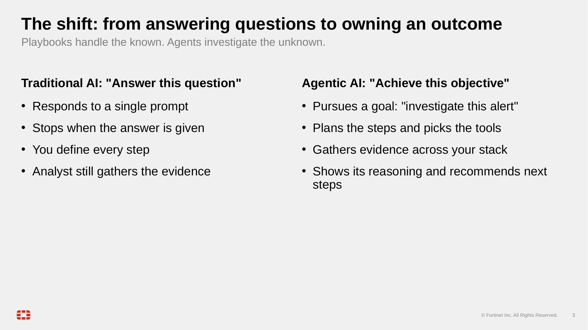
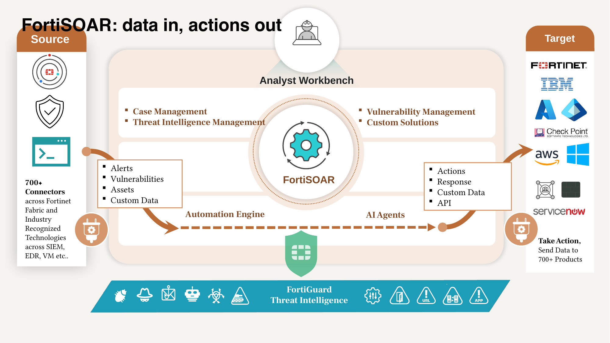
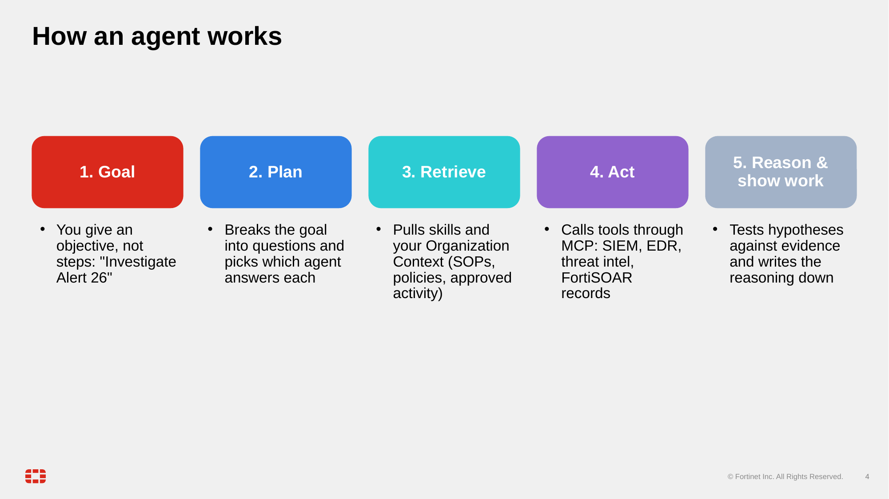

This workshop uses three ideas. An **agent** is an LLM in a loop that decides which tool to call next. A **tool surface** is the set of actions the agent may take. A **verification step** is how you check that a tool call actually worked.

The shift this workshop is about: a playbook does the same thing the same way every time. An agent gets an objective and works out the steps itself.

FortiSOAR sits between your data sources and the products you act on. Alerts and records come in. The automation engine and AI agents reason over them. Actions go out to the tools you connect.

## What MCP is

MCP (Model Context Protocol) is the standard plug between agents and tools. A server lists its tools with typed inputs. The agent reads that list, picks a tool, sends arguments and gets a result. The agent product (Claude Code, OpenCode or Copilot) does not need to know anything about FortiSOAR. It sees tools such as `search_records` and reads their descriptions.

Whichever surface it runs on, an agent follows the same loop: you give it a goal, it plans the questions, it looks up what it knows about your environment, it acts through its tools, and it writes down its reasoning.

An MCP connection has a caller and a thing being called. This workshop uses both directions:

- In **Part 1, chapter 5**, FortiSOAR is the caller. You register an outside MCP server, and FortiSOAR's agents call it.
- In **Part 2**, FortiSOAR is the thing being called. A program on your laptop (`fsr-agentic-toolkit`) lets your coding agent call into FortiSOAR.

## The FortiSOAR objects you will use

- A **module** is a type of record that FortiSOAR stores, such as Alerts, Assets or Users. A **record** is one entry in a module, such as one alert.
- A **connector** links FortiSOAR to an outside product, such as a firewall or a threat-intel service. Its **operations** are the actions it can run.
- A **playbook** is an automation you build once. It has a trigger and a sequence of steps. An agent reasons freshly each time. A playbook does the same thing each time.

The glossary in chapter 11 defines the rest of the terms.

## The two surfaces in this workshop

**Part 1: inside FortiSOAR.** FortiSOAR 8.0.1 includes its own agent layer. FortiAI agents run on the platform, reason with the LLM you configure, and reach the platform's MCP servers. They can also reach any external MCP server you register. You drive all of this from the FortiSOAR UI.

**Part 2: outside FortiSOAR.** Your coding agent runs on your workstation. It connects to the box through the `fsr-agentic-toolkit` MCP server, which is built on the open-source pyfsr SDK. You need the box URL and a user login. The toolkit gives the agent the REST API and a set of higher-level workflows, such as orienting on a box, debugging a playbook run and building a playbook.

{}
Part 1 features run on the appliance. They need AI features turned on and an LLM configured. Part 2 needs only network access to the box and a user login.
{}

## The safety model

An agent that can write to a SOC platform needs limits. Part 2's server enforces three of them:

1. **Approve every write.** Before any tool changes data, your coding agent shows you the call and waits for your yes. The server marks each tool as a read or a write, and the agent decides what to ask about. Chapter 6 shows the prompt in each agent.
2. **Confirm-gated tools.** Deletes, schema publishes, user creation and connector installs refuse to run unless the call includes `confirm: true`. A good agent tells you what will change and asks before it sets that flag.
3. **Verify the effect.** A 200 response only means the server accepted the request. After every write, read the state back. Fetch the record that was created, watch the playbook run that was triggered, or healthcheck the connector that was installed.

Part 1 has its own controls. Approval steps pause mutating actions for a person. These are not identical to Part 2's controls. Chapter 2 shows what each Part 1 path can and cannot change.

## Credits

Part 1's topic structure builds on the FortiSOAR Agentic AI Demo workshop by Mahdi Naili, the original agentic workshop for FortiSOAR. The **Invoke AI Agent** operation that chapter 4 uses comes from Mahdi Naili and Priyank Mankad's build of the Remote FortiSOAR connector. The hands-on steps, text and screenshots here are original to this workshop.
