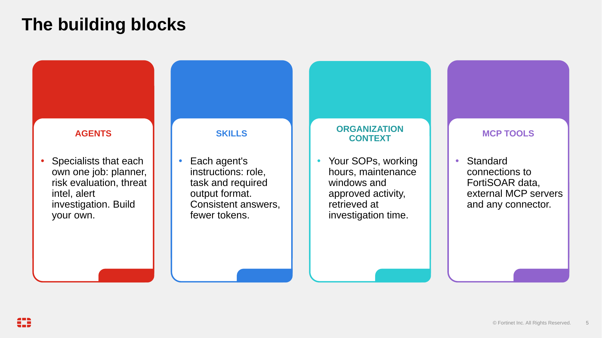

Before you build anything, agree on the words. FortiSOAR Agentic AI has more moving parts than most features, and the same word can name a screen in one place and a naming convention in another. This page gives you the vocabulary used in the rest of the workshop, and a picture of how a request flows through it.

Four building blocks carry most of that vocabulary: the agents that do the work, the skills that instruct them, the organization context that grounds them in your environment, and the MCP tools they reach data through.

## 1. Learn the vocabulary

| Term | What it means | Watch out for |
|---|---|---|
| FortiSOAR Agentic AI | The umbrella for agents, MCP servers, LLM routing and investigation features | "FortiAI" is the name you see in some settings. Use "FortiSOAR Agentic AI" for the whole feature. |
| AI features enablement | A system-level switch. Until it is on, the AI services refuse work. | Turning it on also records acceptance of AI terms. You turn it on in the next lesson (the orientation tour). |
| Agent | A packaged unit: a manifest, a Python class, prompts and an optional tool allowlist | Agents are code bundles, not a point-and-click designer. Chapter 4 covers them. |
| Agent tag | A routing gate. `Triage` lets the investigation planner use an agent. `Insight` lets insight planning use it. `Assistant` is reserved for designer widgets. | An untagged agent is invisible to the planner. |
| MCP server | A server that exposes tools to agents over the Model Context Protocol | Built-in servers ship with FortiSOAR. External ones are registered by you (chapter 5). |
| LLM profile | A named model configuration that agents point to | Profile names may differ on your build. |
| Prompt | A named prompt record (system instruction, user instruction, response format) that an agent calls by UUID | Prompts shipped in code can be re-imported on upgrade, which reverts edits. |
| Skill | Not a separate feature in the product | The word appears as a prefix in prompt names, such as `Skills - <persona> - <task>`. Treat it as a naming convention. |
| Organizational context | Records that shape investigations: SOPs, the tool table, risk criteria, approved activity, role profiles | Do not assume the records you need already exist. Check the list. |
| SOP | An organizational context record in the investigation SOP category. Its subcategory is an alert type, or `DEFAULT`. | Lookups are exact and case-sensitive. `working_hours` does not match `WORKING_HOURS`. |
| Plan | The ordered question list the planner writes before evidence is gathered | It is written once. Answers do not trigger re-planning. |
| Hypothesis | A candidate explanation, such as benign, malicious or suspicious, with questions that support or weaken it | Hypothesis statuses are confirmed, ruled out or inconclusive. |
| Verdict | The alert-level classification: Malicious, Suspicious, Benign, False Positive or Inconclusive | "Confirmed" is a hypothesis status, not a verdict. |
| Trace | The execution tree for one run: agent steps, LLM calls, tool calls and token counts | Prompts stored in a trace are masked. |
| Masking | Regex masking of indicators such as URLs, IP addresses, hashes and emails before LLM calls, reverted afterwards | Masking is not a privacy guarantee. It covers LLM messages only. |
| Orchestrator | A multi-step request engine that plans tasks from installed agents and pauses for approval on writes you did not ask for | It is not an alert-bound pipeline, and it may be marked "for testing" on your build. |

{}
Some product walkthroughs label the alert investigation agent as "the orchestrator". They are different things. The investigation is a fixed pipeline for alerts. The orchestrator plans work from a question. Learn them separately, as this workshop does.
{}

## 2. Follow a request through the stack

Under the hood, the pieces talk in a fixed loop. The agent asks its MCP servers what tools exist, pulls its skills and your organization context, then hands the question and the tool list to the model. The model only ever picks a tool; the agent makes the call through MCP, and every step lands in the trace.

Every request starts with an intent: an analyst clicks a button, types a question, or a playbook calls an API. From there, the path depends on what kind of intent it is.

1. **Intent.** An alert investigation, an AI Assistant question, an insight, or a direct agent call.
2. **Control.** The alert investigation runs a fixed sequence of stages. The orchestrator and the insight planner instead decide which agents to run, so their path varies with the question.
3. **Agents.** Reasoning agents call the LLM. Tool-using agents call the MCP tools they are allowed to use.
4. **Context.** Organizational context (SOPs, the tool table, risk criteria) and the linked records shape the questions and the answers.
5. **Results.** A verdict and summary are written back to the alert, or an insight card is updated. The trace records every step.

An alert investigation moves through these stages, in this order, on every run:

- normalization
- jailbreak check
- context enrichment
- hypothesis
- investigation plan
- evidence gathering
- evidence evaluation
- verdict
- write-back

On 8.0.1 the trace shows these step labels, in roughly this order: `normalization`, `context_enrichment`, `hypothesis`, `investigation_plan`, `investigation_execution`, `hypothesis_evaluation`, `key_finding`, `verdict` and `next_action`. Reading them top to bottom is reading the pipeline in order. The exact set may differ on other 8.0.x builds.

{}
Menu locations and labels differ across 8.0.x builds. Start from the AI area of the left navigation and look for the item name, not for an exact click path. Exact navigation may differ by 8.0.x version.
{}

## 3. Know where the knobs are

You will tune four things during the workshop. Find each one before you need it:

- **Organizational context**: SOPs, the tool table and risk criteria, under the AI configuration area.
- **Agents**: the agent catalog, where each agent shows its LLM profile, its MCP servers and its masking settings.
- **Prompts**: the prompt records that agents call by UUID. Editing them in the UI may be limited on your build.
- **MCP servers**: the list of built-in and registered servers, covered in chapter 5.

## What you will do next

The next page covers which paths can change data and the rule for approvals. The orientation page after it walks through the screens on your own box, read-only.

