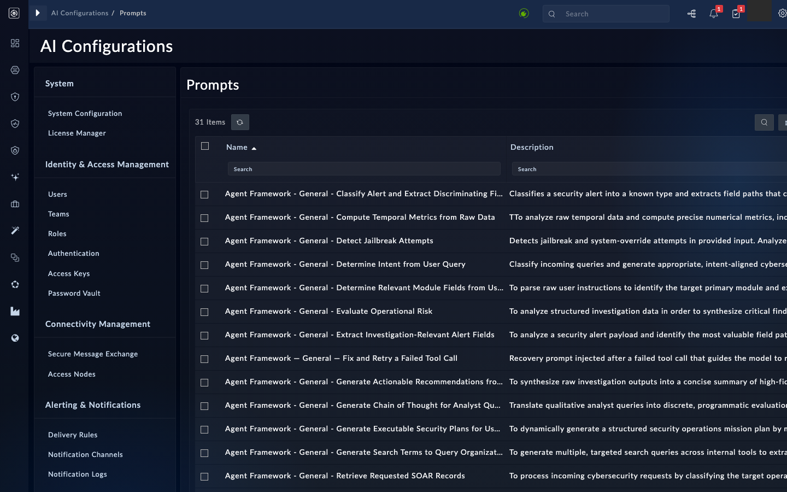
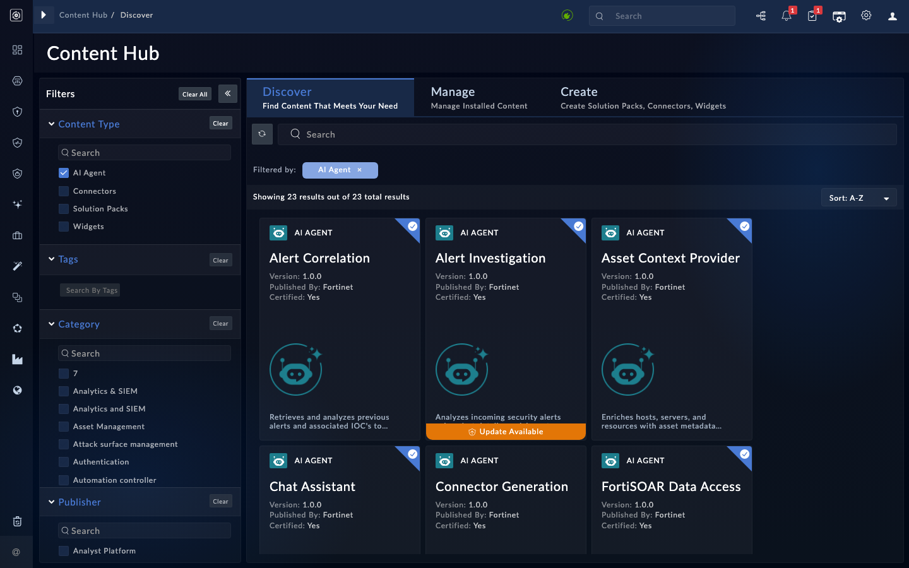
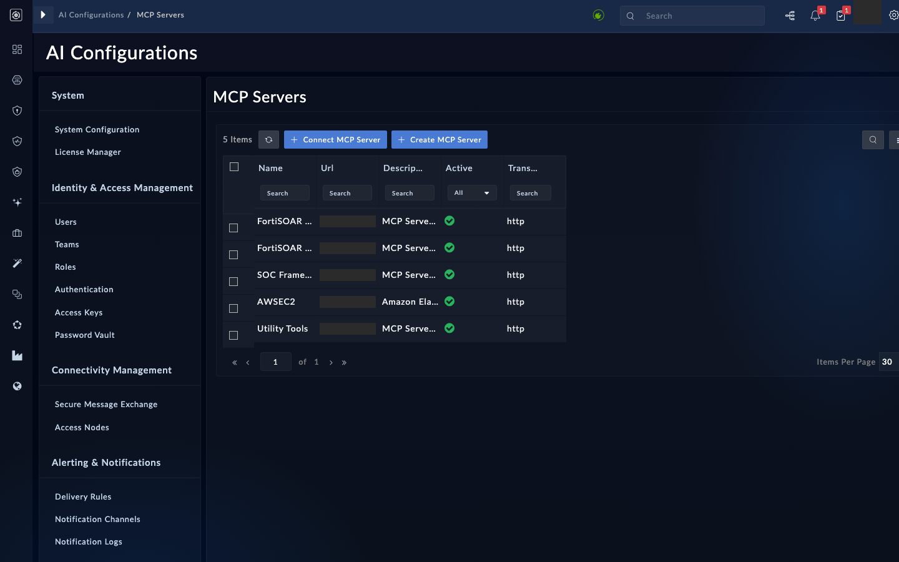

This tour is read-only, with one exception: you will ask the AI Assistant a question about an alert. Nothing here should change data on the box. The goal is to know where things are before chapter 3 starts writing alert fields.

## 1. Seed the data first

Investigations need an alert with source data. Without it, the alert gets the generic `DEFAULT` SOP, and an SOP for its alert type never applies.

{}
An alert created by hand, or through the API, with no raw source data always gets the `DEFAULT` SOP. Type-specific SOPs only apply when the alert carries its source JSON. Put the raw payload in the alert's **source data** field when you seed it, or the SOP exercise in chapter 3 will not show what you expect (NLV-03-05).
{}

Seed three to five alerts before chapter 3. Give each one a JSON payload in the source data field, with placeholder values. For example:

```json
{
  "alert_type": "<alert-type-name>",
  "indicator": "<placeholder-indicator>",
  "source": "<your-sensor-name>",
  "severity_raw": "<raw-severity>"
}
```

Include one alert with no source data at all. You will use it in chapter 3 to show the `DEFAULT` SOP behavior.

## 2. Confirm AI is on

Open the AI Configurations group of the left navigation and read what it shows. It holds MCP Servers, Prompts, Organizational Context and Insights. The agent catalog is not in this group; it is in the Content Hub (step 3).

<!-- step: fsa02-01-ai-enabled manual -->

1. Look for the AI Configurations group in the left navigation.
2. Confirm there is no "AI feature not enabled" banner. The enablement switch and the token balance are under **System** > **System Configuration** > **FortiAI**, not in the AI Configurations group (NLV-02-01).
3. If a token balance is shown there, note it. Do not change any setting.

<!-- capture: fsa02-01-ai-area -->


**What success looks like**

- The AI area opens without an enablement banner.
- You can say where the token balance appears, or that it is not shown on your build.

{}
Enabling AI features is an administrator task. If the banner appears, ask your instructor or box administrator to enable it. Do not work around it.
{}

## 3. Read the agent catalog

<!-- step: fsa02-02-agent-catalog manual -->

Open the **Content Hub**, go to **Discover**, and tick **AI Agent** under Content Type. The catalog lists the shipped AI agents (23 on the build this page was checked against) (NLV-02-02). Filter by tag, then open one agent tagged `Triage` and one tagged `Insight`. For each, write down:

- the LLM profile it points to
- the MCP servers it is allowed to use
- its masking setting

<!-- capture: fsa02-02-agent-list -->


**What success looks like**

- You can say which tag routes an agent into an investigation and which routes it into insights.
- You can name the MCP servers one `Triage` agent uses.

## 4. Inspect the MCP servers

<!-- step: fsa02-03-mcp-servers manual -->

Open the MCP servers list under AI Configurations. Identify the built-in servers and say what each one is for. The build this page was checked against lists five, all active and all on the HTTP transport:

- **FortiSOAR Module Management**: reads and writes records and modules.
- **SOC Framework**: alert and indicator tools.
- **FortiSOAR Playbook Management**: runs playbooks and reports their status.
- **Utility Tools**: helper tools.
- **AWSEC2**: a connector-based server. It wraps an installed connector's operations as tools, so it is not one of the three FortiSOAR families.

<!-- capture: fsa02-03-mcp-list -->


**What success looks like**

- You can name the built-in servers and their purpose.
- You can tell which servers are built in and which wrap a connector.

If the names on your build differ, use what the list shows (NLV-02-04).

## 5. Compare an SOP with the planner

<!-- step: fsa02-04-sop-compare manual -->

Open the organizational context records for investigation SOPs. Find the `DEFAULT` SOP, and one SOP for an alert type. Read the question lists they contain.

You will compare these with the questions the planner actually writes in chapter 3. Come back to this step then.

**What success looks like**

- You can point to where an SOP's questions are stored.
- You understand that SOP lookups are exact and case-sensitive. A subcategory that differs in case from the alert type does not match.

If you cannot find the SOP records under the AI configuration area, check the list view for the organizational context module. Its name and location are NLV-02-11.

## 6. Ask the assistant a read-only question

<!-- step: fsa02-05-assistant-readonly manual -->

Open an alert you seeded in step 1. Use the AI Assistant on that alert and ask a question that only reads data, such as:

```text
Summarize the source data on this alert and list the indicators it contains.
Do not change anything.
```

Then ask one multi-step read-only question, such as asking for the alert's related records and their status. This is a chat exercise. It is not an orchestrator run.

**What success looks like**

- The assistant answers from the alert's data, without inventing indicators.
- You checked the alert afterward and nothing on it changed.

{}
Keep this chapter read-only. Do not ask the assistant to block, close, assign or update anything on a shared box. Chapter 3 is where alerts start to change.
{}

## Troubleshooting

| Symptom | Likely cause | Fix |
|---|---|---|
| AI area missing from the navigation | Your user lacks AI permissions | Ask your administrator to grant the workshop role AI read access (NLV-00-03) |
| Enablement banner on every AI page | AI features are off | Ask your administrator to enable them |
| SOP looks empty or wrong | The alert has no source data, or the subcategory does not match exactly | Add source JSON to the alert, and check the subcategory spelling and case |
| Assistant invents indicators | The alert has little source data | Add the source payload and ask again |
| Assistant ignores the alert | Question did not name the alert | Name the alert by its title or identifier |

<!-- NLV verdicts (live box pass):
  verified: NLV-02-01 (enablement and token balance under System > System Configuration > FortiAI; the AI area does not show them).
  verified: NLV-02-02 (agent catalog is in Content Hub, Content Type AI Agent; 23 items; corrected location in this page).
  verified: NLV-02-04 (five built-in MCP servers, not four families; AWSEC2 is connector-based; corrected in this page).
  verified: NLV-02-16 (the "Chat Assistant" agent name appears in the catalog).
  corrected: NLV-02-10 (44 organizational context records are present on the box, including the DEFAULT SOP; whether a fresh install ships them is not verified).
  partly: NLV-02-11 (module lives under AI Configurations > Organizational Context; module name not checked).
  partly: NLV-03-05 (a DEFAULT investigation SOP record exists; the no-source-data behavior was not run).
  open: NLV-00-03 (role permissions not tested with a non-admin user), NLV-02-03 (agent configuration fields need an agent detail that was not opened), NLV-02-05 (orchestrator UI status), NLV-02-14 (chat write behavior, not run on a shared box). -->

