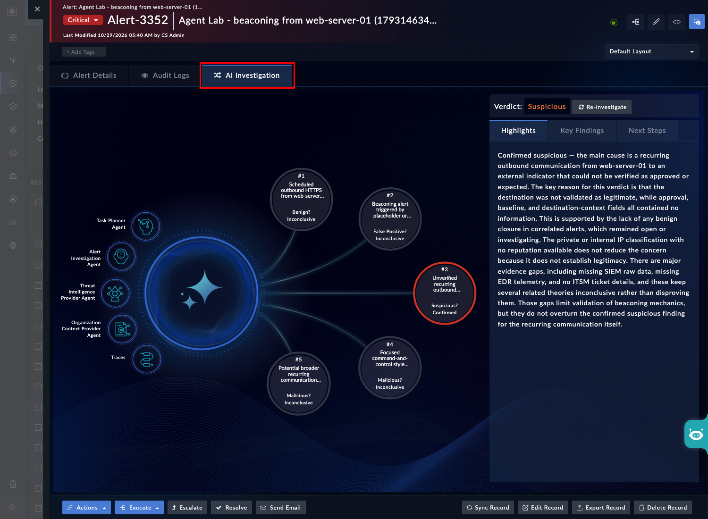
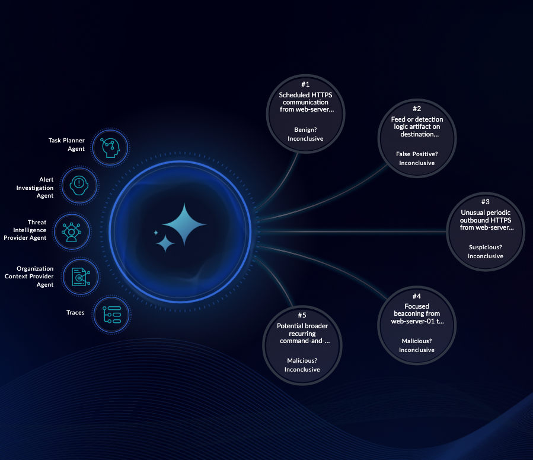
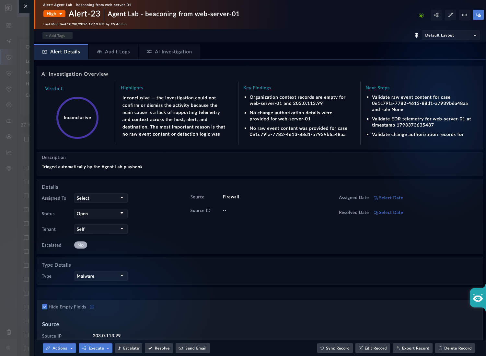
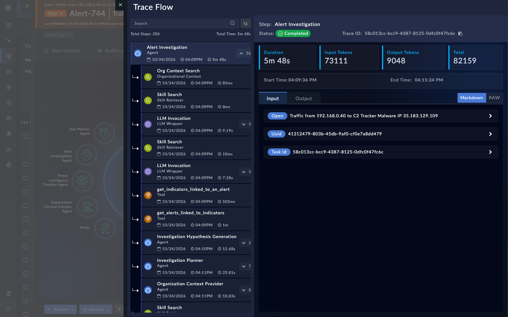

An AI investigation takes one alert and works through it in a fixed order: it classifies the alert, forms hypotheses, plans questions, gathers evidence, scores the evidence and writes a verdict back to the alert. In this page you run one, read it the way an analyst would, and check the write-back before you trust it.

## 1. Know the stages

The stages run in the same order every time. Only the answers change.

| Stage | What happens | Calls the LLM | Calls tools |
|---|---|---|---|
| Normalization | The raw alert becomes a normalized card, classified by type | Yes | No |
| Jailbreak check | An LLM check on the raw alert. An unsafe result ends the run with a blocked summary, and the alert is not updated. | Yes | No |
| Insufficient-data check | A code check. An unknown type with no indicators ends as Inconclusive. | No | No |
| Context enrichment | Linked indicators, alerts and assets are pulled in | No | Yes |
| Hypothesis | Several hypotheses, each with supporting and weakening questions | Yes | No |
| Investigation plan | One question per active row of the tool table, each routed to a `Triage` agent | Yes | No |
| Evidence gathering | Assigned agents answer in parallel, each through its allowed tools | Yes | Yes |
| Evidence evaluation | Each answer is scored as supporting or weakening each hypothesis | Yes | No |
| Verdict | A verdict, key findings and next actions are written back | Yes | Write-back only |

A run typically takes a few minutes. Token use runs to tens of thousands per investigation, depending on the route (NLV-03-08). Plan your token budget before a class run.

{}
The jailbreak check can end a run with a blocked summary while the run still shows as completed. Read the summary, not only the status (NLV-03-19).
{}

## 2. Start an investigation

Open an alert you seeded with source data and a known malicious indicator. Look for the **AI Investigation** tab on the alert, and start the run from there.

<!-- step: fsa03-01-start-investigation manual -->

1. Open the alert and select the **AI Investigation** tab. If the tab is named differently on your build, look for the investigation controls on the alert.
2. Start the run with **Begin AI-Powered Alert Investigation**. If the button has a different label, use the one that starts a new investigation.
3. Wait for the run to finish. Expect a few minutes.

<!-- capture: fsa03-01-investigation-tab -->

**What success looks like**

- The run finishes and the tab shows hypotheses, not an error.
- You can say which indicator the run focused on.

## 3. Read the result

<!-- step: fsa03-02-read-result manual -->

Read the result before you decide anything. For each hypothesis, note:

- its status: confirmed, ruled out or inconclusive
- which questions gave supporting evidence and which gave weakening evidence
- which agent answered each question, and what evidence it used
- which questions had no data at all

<!-- capture: fsa03-02-hypotheses -->

**What success looks like**

- You can explain why the verdict came out the way it did, from the evidence.
- You can name at least one question that had no data, and say what that means for the verdict.

## 4. Verify the write-back

The overview card on the alert shows the verdict, and so does the record. Check the record, because the record is what other automation reads.

<!-- step: fsa03-03-verify-writeback manual -->

Open the alert record itself, not only the overview card. Find the three AI fields the investigation writes: verdict, severity and summary. Confirm they match what the card showed.

<!-- capture: fsa03-03-alert-ai-fields -->

**What success looks like**

- The verdict, severity and summary on the record match the card.
- Nothing else on the alert changed: status, owner and closure are untouched (NLV-03-03).

{}
Check the write, not the card. A card that renders proves only that the page drew it. The record is the evidence.
{}

## 5. Test the edges

Two runs show you the limits of the feature. Run both before you rely on any verdict.

### 5.1 A benign-looking alert

Pick an alert that looks benign, and that matches an activity you have approved. Run an investigation on it.

<!-- step: fsa03-04-benign-rerun manual -->

Expect an Inconclusive verdict more often than a Benign one. In testing, benign-looking alerts often ended Inconclusive. Then add an approved-activity record to the organizational context, with the exact category and subcategory, and run the investigation again. Compare the two results honestly. Whether the answer changes is the finding, either way (NLV-03-04).

**What success looks like**

- You recorded both verdicts.
- You can say whether the approved-activity record changed a question's answer. Report the result even if it did not change.

### 5.2 Source data changes the SOP

<!-- step: fsa03-05-sourcedata-check manual -->

Create one alert by hand with no source data, and one with source JSON for the same alert type. Run an investigation on each. Look in the investigation plan or the trace to see which SOP was applied.

**What success looks like**

- The alert with source data shows its alert-type SOP.
- The alert without source data shows the `DEFAULT` SOP (NLV-03-05).

## 6. Gate the trigger

Do not start an investigation on every alert. Each run costs tokens and minutes.

A common pattern is to score the alert's risk first and investigate only above a threshold. Low-risk alerts stop early. The pattern is a playbook that calls a risk-evaluation agent, branches on the score, and starts the investigation only for medium or high risk. Your build may not ship a risk-gate playbook, so treat that as something you build (NLV-03-09). You build it in chapter 4.

{}
Do not start an investigation from a playbook through an HMAC-authenticated API call. That route runs the investigation without FortiSOAR tools, and the verdict never gets written back. Start investigations from a route that authenticates as a user, and check the write-back afterward (NLV-03-06).
{}

## 7. Read the trace

<!-- step: fsa03-06-trace-review manual -->

Open the trace for your run from section 2. Find the normalization step and the verdict step. Then find one tool call that returned evidence, and read what it returned.

<!-- capture: fsa03-04-trace-steps -->

**What success looks like**

- You found normalization, at least one tool call, and the verdict step in order.
- You can say what the tool returned and whether the hypothesis used it.

{}
In testing, the trace panel stalled after a burst of reads. If it hangs, wait a few minutes and reload. If it stays stuck, ask the box administrator to restart the AI services (NLV-03-07).
{}

## Troubleshooting

| Symptom | Likely cause | Fix |
|---|---|---|
| Run finishes with no hypotheses | The alert has no source data or no type | Add source JSON and run again |
| Verdict is Inconclusive for a clear alert | Missing evidence, or a question with no data | Read the questions that had no data. Add the context they need, then re-run. |
| Write-back is missing after a run | The run did not complete, or the jailbreak check blocked it | Read the run summary. Re-run if it was an error. |
| Run fails in normalization with a quota error | The LLM account is out of credit, though the health check passed | Test the LLM route with a real completion, and top up the account (NLV-05-20) |
| Run fails with an authorization error | The LLM route is not entitled on the box | Ask the administrator to check the route's entitlement (NLV-05-19) |
| Trace panel never loads | A burst of trace reads stalled the service | Wait, reload, then ask for a restart if needed (NLV-03-07) |

<!-- NLV verdicts (live box pass):
  NLV-03-01: verified: the tab is named AI Investigation and the start button reads Begin AI-Powered Alert Investigation (one investigation run for the capture, on the chapter 8 alert)
  NLV-03-02: partly: five hypotheses with Benign/False Positive/Suspicious/Malicious questions and a verdict per hypothesis; the one run returned only Inconclusive outcomes, so Confirmed and Ruled Out were not seen
  NLV-03-03: partly: the verdict and summary are written to the alert record (AI Investigation Overview); severity stayed High and the status and owner were not compared against the audit trail
  NLV-03-04: open: not run in this pass (needs an agent or investigation run, a box write, or the API key)
  NLV-03-05: partly: a DEFAULT investigation SOP record exists; the no-source-data behavior was not run
  NLV-03-06: open: not run in this pass (needs an agent or investigation run, a box write, or the API key)
  NLV-03-07: open: not run in this pass (needs an agent or investigation run, a box write, or the API key)
  NLV-03-08: open: not run in this pass (needs an agent or investigation run, a box write, or the API key)
  NLV-03-09: open: not run in this pass (needs an agent or investigation run, a box write, or the API key)
  NLV-03-19: open: not run in this pass (needs an agent or investigation run, a box write, or the API key)
  NLV-05-19: open: not run in this pass (needs an agent or investigation run, a box write, or the API key)
  NLV-05-20: open: not run in this pass (needs an agent or investigation run, a box write, or the API key) -->
