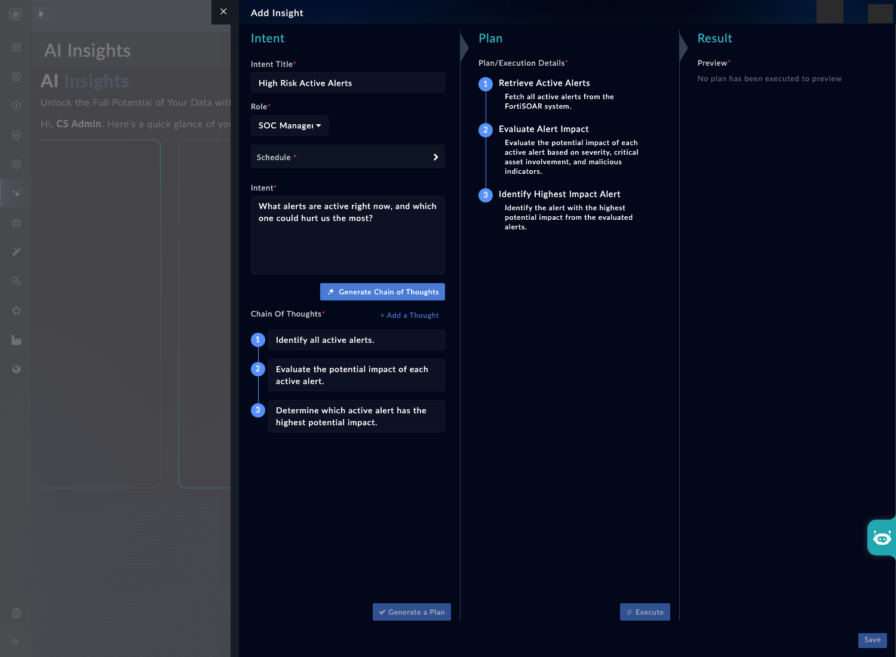
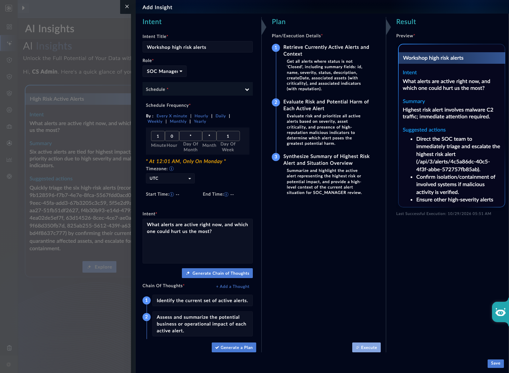

An AI Insight answers a plain-language question about your FortiSOAR data. You give it a question and a role. It proposes a chain of thought and a plan, runs the plan, and returns a summary card. You can save it and schedule it. In this page you create one, read it before it runs, and decide whether to schedule it.

## 1. Know the flow

1. **Question.** Write it in plain language, or pick a template.
2. **Role.** Pick the persona the answer should be written for, such as SOC Analyst or SOC Manager. The role shapes the plan and the summary.
3. **Chain of thought.** The platform proposes its reasoning. You can read it. It is editable on some builds (NLV-03-12).
4. **Plan.** The platform proposes the steps it will run. Read it before you run it.
5. **Execution.** Each step runs through one insight agent. A run stops on an error or on an empty fetch.
6. **Summary card.** A concise summary, suggested actions and the last execution.
7. **Schedule.** Saving can create a schedule. Each run executes as the insight's creator.

Insight agents are read-only. They have no write tools and no approval step, so an insight cannot change alerts (NLV-03-15).

## 2. Create an insight

Open the AI Insights area from the AI navigation (NLV-03-10). Add a new insight. If a template is offered, pick one such as a high-risk alert review (NLV-03-11). Choose the role **SOC Manager**, or another role your build offers.

<!-- step: fsa03-07-create-insight manual -->

Enter a question in plain language, for example:

```text
Which active alerts have the highest risk score, and which of them have no assigned owner?
```

Do not run it yet. Move to the next step.

<!-- capture: fsa03-05-insight-plan -->


## 3. Read the chain of thought and the plan

<!-- step: fsa03-08-read-plan manual -->

Read the chain of thought, then the plan. Check that the plan's steps match the question. If a step fetches data you did not ask for, change the question, not the plan.

Do not edit the chain of thought in this exercise. In testing, editing it did not reliably change the generated plan, and an edited run once failed because its filters did not match the data on the box (NLV-03-12).

**What success looks like**

- You can say, for each plan step, what data it fetches.
- You can point to one step that would not answer the question, if your plan has one.

## 4. Run, save and schedule

<!-- step: fsa03-09-schedule-insight manual -->

Run the insight. When the summary card appears, read the summary and the suggested actions. Save it. If you schedule it, pick a short interval such as weekly and note who the schedule runs as.

<!-- capture: fsa03-06-insight-card -->


**What success looks like**

- The summary card shows a summary, suggested actions and an execution record.
- The schedule names the creator, and you know that scheduled runs use the creator's access.

{}
A schedule runs as the user who created it. If an administrator creates a schedule, it sees what an administrator sees. Create schedules as the least-privileged user who needs the answer.
{}

{}
Suggested actions can list record identifiers rather than alert names. Look the record up before you act on it.
{}

## 5. Accept an honest "no data" answer

An insight can return "no data" instead of a guess. That is a valid result. If your question returns nothing, check the plan's filters before you change the question. A filter on a status value your box does not use returns nothing without an error (NLV-03-20).

Do not rely on the drill-down chat from the summary card. In testing, the drill-down question did not return an answer (NLV-03-13). Use the insight itself, or start a new insight with a narrower question.

## Troubleshooting

| Symptom | Likely cause | Fix |
|---|---|---|
| Plan returns "no valid alert data" | A filter uses a status value your box does not use | Reword the question, or check the status values on your box (NLV-03-20) |
| Run never finishes | Plan is large or the LLM route is slow | Wait a few minutes, then cancel and re-run with a narrower question |
| Drill-down chat never answers | Known gap in testing | Start a new insight with a narrower question (NLV-03-13) |
| Schedule missing after save | Your user cannot create schedules | Ask an administrator to check your permissions (NLV-03-10) |
| Edited chain of thought ignored | Editing does not reliably change the plan on some builds | Re-create the insight with the question changed instead (NLV-03-12) |

<!-- NLV: NLV-03-10, NLV-03-11, NLV-03-12, NLV-03-13, NLV-03-15, NLV-03-20 -->
