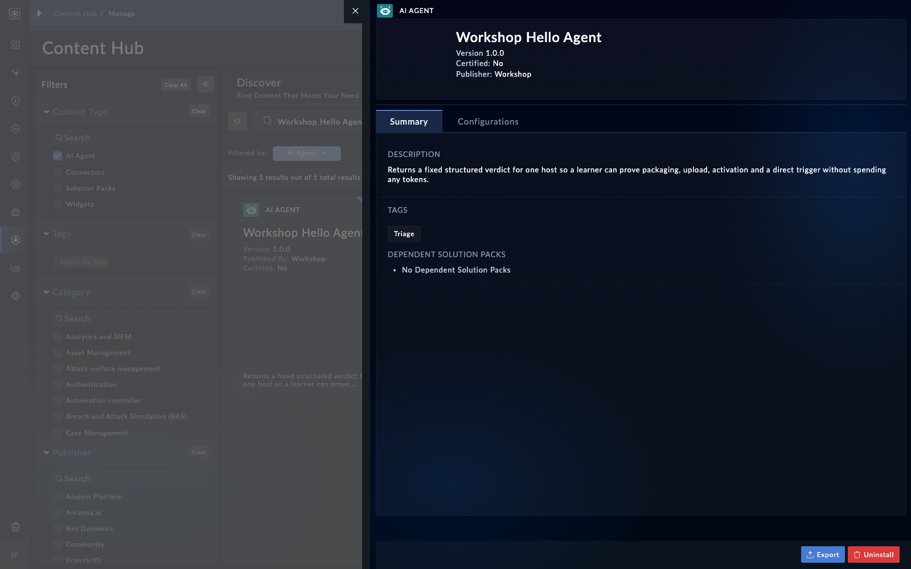
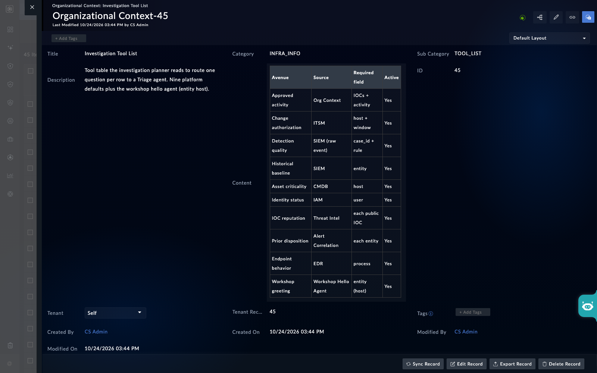

In this page you package a small agent, upload it, prove it runs, and then make an investigation send it a question. The last step is the one most people miss: a tag alone does not route a question to your agent. The tool table does.

## 1. Package the bundle

Zip the bundle folder so that its top-level folder has the same name as the `name` in `info.json`. Validate the manifest before you upload it. A validator checks the required fields and the requirements file (NLV-04-15).

{}
Upload is gated by an **Advanced Development Settings** toggle that controls the agent upload control. Ask your administrator to turn it on for the workshop user. The label and location may differ on your build (NLV-04-16).
{}

## 2. Upload it

Open the AI area and look for the agent upload control. If you do not see one, check the Advanced Development Settings toggle first. Upload the zip.

If the upload fails with a multipart or "field required" error, the request is not reaching the AI service as a file. Ask your administrator which import path your build supports for agent bundles (NLV-04-03).

{}
A failed import is not rolled back. The unpacked folder can stay on the box. Every later import of the same name then fails with "File exists", even with replace. Clear the leftover folder on the box with the administrator, then import again (NLV-04-04).
{}

After import, check that the agent is active. Some builds import agents inactive until you activate them (NLV-04-06).

## 3. Prove it runs: a hello agent

Your first agent should not call an LLM. Make it return a fixed structured answer built from its input. That proves packaging, import, activation and a direct call.

<!-- step: fsa04-01-hello-agent manual -->

Open the agent's detail page. Trigger it directly, using the agent's trigger route with the agent name in the path. Send one input with the entity your `inputformat` declares.

<!-- capture: fsa04-01-agent-detail -->

**What success looks like**

- The result is returned with `answer`, `confidence` and `evidence` keys.
- The run shows as a task you can poll for its result.

If your build has no trigger control on the detail page, call the agent's trigger route directly, with the same input, from an API client. If the route form differs on your build, use the form the documentation for your build gives (NLV-04-12). Calling it needs execute and read rights on AI agents (NLV-04-13).

## 4. Route an investigation to it

Tagging the agent `Triage` is necessary but not sufficient. The investigation plans one question for each row of the tool table. It routes each question to a `Triage` agent based on the row. An agent with no row gets no question.

The recipe has three steps:

1. Tag the agent `Triage`, give it a description the router can match, and declare the entity it needs in `inputformat`.
2. Install and activate it.
3. Add a row for it to the `TOOL_LIST` record in organizational context, under the infrastructure information category.

{}
`TOOL_LIST` replaces the built-in tool table for every investigation, not just yours. Copy all nine default rows into the record before you add your row. If you leave a default row out, or write a record with only your row, the questions for that row stop. Setting a row to No stops its questions too.
{}

The nine default rows are:

- Approved activity
- Change authorization
- Detection quality
- Historical baseline
- Asset criticality
- Identity status
- IOC reputation
- Prior disposition
- Endpoint behavior

Export or copy the current `TOOL_LIST` record first, then add your row. Do not retype the defaults from memory, because the names and fields must match what the record already holds (NLV-04-08).

<!-- step: fsa04-02-tool-list-row manual -->

Open the `TOOL_LIST` record. Add one row for your agent. Its description should name the entity the agent needs, such as a host, and the kind of evidence it returns. Keep the nine defaults.

<!-- capture: fsa04-02-tool-list-record -->

**What success looks like**

- All nine defaults are still present, and your row is the tenth.
- The record saves without an error.

## 5. Check the route with a test investigation

<!-- step: fsa04-03-route-check manual -->

Run an investigation on a seeded alert that has the entity your agent needs. When the run finishes, open its trace and find the question your row produced. Then find the call to your agent.

**What success looks like**

- The trace shows a question for your row.
- The question was answered by your agent, and the answer reached the summary or the next actions.

{}
The routing instruction in the platform names the built-in agents with a fixed mapping. Routing to your agent worked in testing, but a strong mismatch between the row and your description may not route. If your question goes to a built-in agent instead, tighten your row's wording first. Changing the routing instruction itself is an export, edit and re-import, and an upgrade reverts it (NLV-04-09).
{}

## Troubleshooting

| Symptom | Likely cause | Fix |
|---|---|---|
| Upload fails with "field required" | The upload is not reaching the AI service as a file | Ask the administrator which import path your build supports (NLV-04-03) |
| Every later import fails with "File exists" | A failed import left its folder on the box | Have the administrator delete the leftover folder, then import again (NLV-04-04) |
| Agent runs but the investigation never asks it anything | No `TOOL_LIST` row, or the row is set to No | Add the row, and keep the nine defaults (NLV-04-08) |
| Investigation stops asking the default questions | `TOOL_LIST` was replaced with a short table | Restore all nine default rows from the export |
| Agent dies during `act()` with a null-reference error | `self.initialize()` was not called | Call it first in `act()` (NLV-04-17) |
| "Tool not allowed" when the agent calls a tool | The server UUID in `memory.yaml` is wrong, the server is missing from the agent config, or the tool name changed | Check all three. Read the tool names from the server's list, not from memory (NLV-04-14) |
| Agent list call fails for everyone | A manifest key was left out and stored as null | Declare every key, using an empty value where you have nothing (NLV-04-15) |
| Replace import gives the agent a new ID | Replace creates a new UUID on some builds | Check the allowlist and the agent config after every replace (NLV-04-05) |

<!-- NLV: NLV-04-03, NLV-04-04, NLV-04-05, NLV-04-06, NLV-04-08, NLV-04-09, NLV-04-12, NLV-04-13, NLV-04-14, NLV-04-15, NLV-04-16, NLV-04-17 -->
