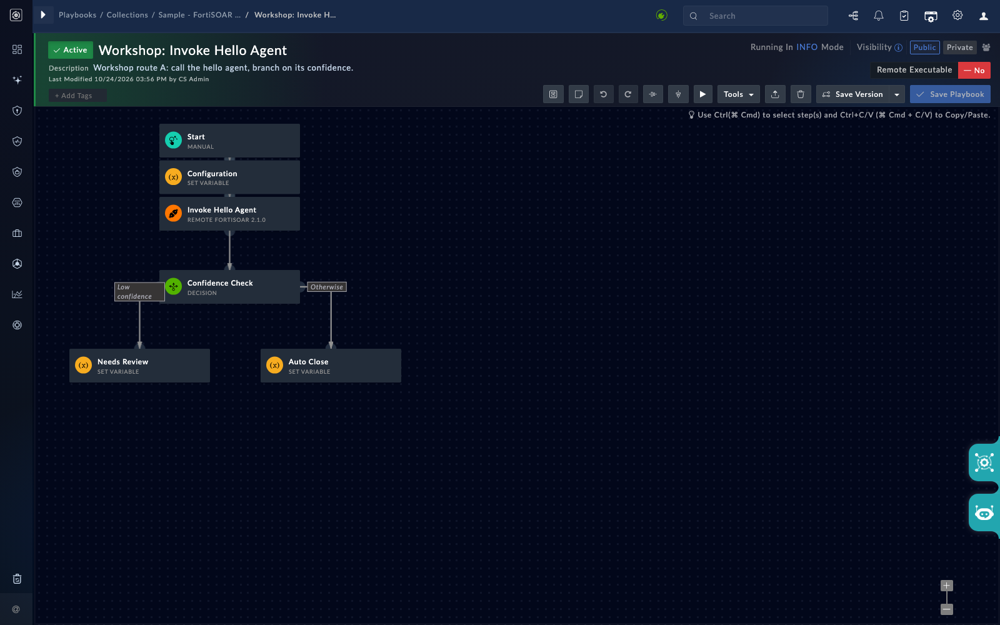

A playbook is where an agent's answer turns into action, so the way the playbook calls the agent matters. This page explains the three routes, which one to use, and how to branch on the result. The rule is simple: a playbook should call an agent through a route that authenticates as a user, and any write should come after a manual-input step.

## 1. Know the options

| Route | How it calls the agent | Works for | Notes |
|---|---|---|---|
| A. Remote FortiSOAR connector with a user login | A connector configured with a real user login calls the agent's trigger route | Reasoning agents and tool-using agents, with the user's rights | Use this when your build's connector exposes an agent action. In testing, a start authenticated with an API key was rejected, so use a user login. |
| B. Utility API call with HMAC | The "Make FortiSOAR API Call" step calls the agent's trigger route, authenticated with HMAC | Reasoning-only agents, with no MCP tools | An agent that needs MCP tools gets an authorization failure from the built-in servers. |
| C. Starting a full alert investigation through the HMAC route | The same HMAC call, but it starts an investigation | Nothing reliable | The investigation runs without FortiSOAR tools, and the verdict is never written back. Do not use this route for investigations. |

{}
Do not use a modified connector package that adds an agent action to a playbook. It is not a supported route, and a package like that can break on upgrade. Use route A if your build supports it, and route B for a reasoning-only agent.
{}

## 2. Follow the teaching path

Work through the routes in this order:

1. Start with a **reasoning-only** agent. It needs no MCP tools, so route B will work for it. Run it through route B to see the limit clearly: route B cannot reach an agent that needs tools.
2. Then call the same agent through route A, if your build's remote connector exposes an agent action.
3. Only after that, try an agent that uses a read-only tool, through route A.

## 3. Build the playbook

Build a playbook in the playbook designer. The trigger is up to you. A common shape is:

1. A trigger that starts on a record event.
2. A call to your agent, through route B for the reasoning-only agent.
3. A branch on the agent's `confidence` or `answer` value.
4. A manual-input step before any change, so a person approves it.
5. The change itself, only on the approved branch.

<!-- step: fsa04-04-playbook-route-b manual: invokes the lab agent from a playbook; spends tokens -->

Build the reasoning-only agent call through route B. Run the playbook against a seeded alert. Open the run and read the agent's returned fields.

<!-- capture: fsa04-03-playbook-branch -->

**What success looks like**

- The run completes and the agent's `answer` and `confidence` are visible in the step's output.
- The branch takes the path you set for the confidence value you got.

## 4. Repeat through route A

Once route A is available on your build, build the same call through the remote connector with a user login. Confirm the same branch works.

<!-- step: fsa04-05-playbook-route-a manual: invokes the lab agent from a playbook; spends tokens -->

**What success looks like**

- The agent's answer comes back through the connector step.
- The connector is configured with a user login, not an API key.

If the connector has no agent action on your build, record that and stop at route B. Do not work around it with a modified package.

## 5. Check the upgrade path

An upgrade can keep an agent's configuration but overwrite its code. Test that before you rely on a replaced agent.

<!-- step: fsa04-06-replace-check manual: re-imports the agent with replace and re-runs the playbook; the re-run may call FortiAI -->

Re-import the agent with replace. Note its ID before and after. Check that its allowlist and agent configuration are still in place. Run the playbook again.

**What success looks like**

- The playbook still calls the agent and gets an answer.
- You recorded whether the agent ID changed.

## Troubleshooting

| Symptom | Likely cause | Fix |
|---|---|---|
| Route B returns an authorization error for an agent | The agent needs MCP tools, and route B cannot authenticate to them | Use route A, or choose a reasoning-only agent for route B |
| Route A rejects the connector | The connector uses an API key, not a user login | Reconfigure it with a user login |
| No agent action in the connector | Your build does not expose one | Stop at route B, and record that for the group |
| Branch always takes the default path | The branch reads a field that is not in the output | Read the actual output of the step and branch on that field |
| Investigation started from a playbook has no verdict | Started through the HMAC route | Start investigations through a user-authenticated route, and check the write-back |
| Agent gone after replace | The agent was replaced and its ID changed | Re-link the playbook step to the new ID |

