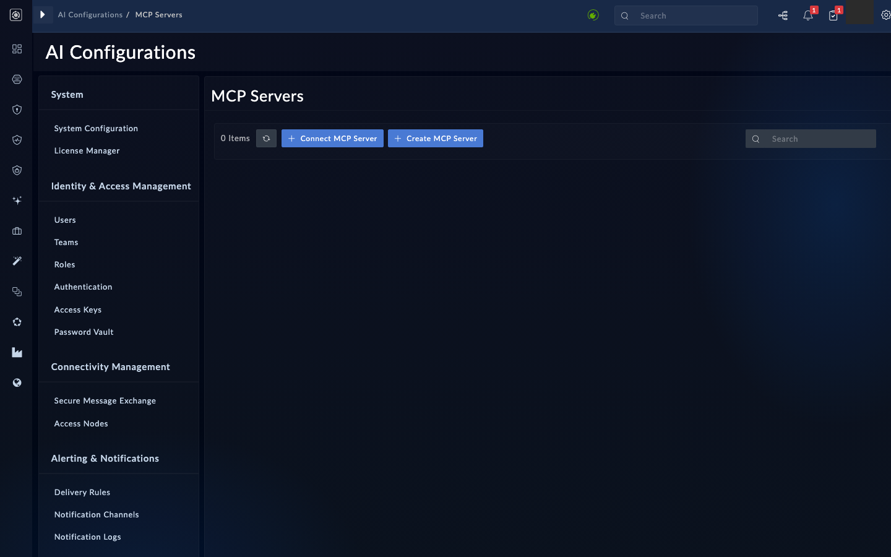

The Model Context Protocol (MCP) is how an agent reaches tools that live outside it. A server exposes named tools. A client calls them over JSON-RPC, and the server describes each tool's input schema so the model knows how to call it. FortiSOAR gives agents access to MCP servers in three ways, and this page covers how you register one of them.

## 1. Know the three kinds of server

| Kind | What it is | Who makes it |
|---|---|---|
| Built-in | Four families that ship with FortiSOAR: module management (records), utility tools, SOC framework (alert and indicator tools), and playbook management (run and status) | FortiSOAR |
| External | A remote MCP server that another product hosts, registered with FortiSOAR by its URL. The flagship case: FortiSIEM hosts an MCP endpoint, you register it once, and FortiSOAR agents can query SIEM incidents, reputation and inventory as tools. Any server you run yourself registers the same way - including one running on the FortiSOAR CLI itself on a local port. | The other product, or you |
| Connector-based | A server built from installed connector operations. Each selected operation becomes one tool, and its inputs are nested under one `params` object. | FortiSOAR, from your choices |

If you have a FortiSIEM in your lab, register its MCP endpoint as this chapter's external server: it is the realistic production shape (a vendor-hosted remote server with `oauth2` authentication, where the token refreshes itself). The next page's lab server exists for classes without one.

Five system connectors can never become MCP tools (NLV-05-08). An MCP tool has no built-in notion of read-only or destructive, so the approval for any write belongs in a playbook with a manual-input step, not in the tool.

## 2. Pick a transport and an authentication type

Use HTTP, meaning streamable HTTP, for every server in this workshop. The `sse` transport is older, and `stdio` runs only a short list of allowlisted commands, so it is not a good fit for a lab server (NLV-05-12).

| Authentication type | What the call sends | Use it for |
|---|---|---|
| `none` | No header | A trusted lab server only |
| `bearer` | `Authorization: Bearer` with your token | A static token that your server issues |
| `api_key` | A named header with your key | Servers that use an `X-API-Key` style header |
| `basic` | Basic authentication | Legacy servers |
| `custom` | An arbitrary header map | When nothing else fits |
| `fsr` | The caller's own FortiSOAR token | Servers that check FortiSOAR tokens themselves |
| `oauth2` | An OAuth flow | Vendor services that require it (NLV-05-03) |

Type names may be case-sensitive. Try the lowercase form first, and check the list on your build (NLV-05-02).

On the build this page was checked against, the **Connect New MCP Server** form offers only the `http` transport and has no authentication field (NLV-05-02, NLV-05-03). The table above and the rule in section 3 describe the stored record. Check them against your build before you rely on them.

The `fsr` type passes the caller's own FortiSOAR token through, as the built-in servers do. A static token gives every call the same identity, so one shared token means one shared identity (NLV-05-11). Choose the type with that trade-off in mind.

## 3. Read the JSON-string rule first

{}
The `authentication` field must be sent as a JSON string, not as a JSON object. If you send an object, the platform stores the text `Array` in its place. Then the status route fails for every registered MCP server, not just the one you got wrong. Serialize the authentication value to a string before you send the record.
{}

The pattern looks like this. The inner keys shown are illustrative. Match the shape your build expects (NLV-05-05).

```json
{
  "name": "weather-lab",
  "type": "external",
  "transport": "http",
  "url": "https://mcp.example.com/mcp/",
  "active": true,
  "authentication": "<the same JSON, sent as a string>"
}
```

Wrong, because the value is an object:

```json
"authentication": {"type": "bearer", "token": "<your-bearer-token>"}
```

Right, because the value is the same JSON, serialized as a string:

```json
"authentication": "{\"type\": \"bearer\", \"token\": \"<your-bearer-token>\"}"
```

Never put a real token in a file you commit. Use the placeholder in the workshop and set the real value through the UI or the API, then rotate it after the class.

## 4. Register: validate, persist, then check status

The registration has four steps. Do not skip the first one.

1. **Validate.** Send the server definition to the validation route. The platform connects to the server, lists its tools and returns their names. If validation fails, do not persist.
2. **Persist.** Save the definition through the MCP configurations route. Note the UUID the platform returns. You need it for every allowlist.
3. **Check status.** Read the status for the server. A healthy server shows as active with its tools.
4. **Grant.** Add the server's UUID and the tool names it may use to each agent that should call it. Chapter 5, page 2, covers the grant.

<!-- step: fsa05-01-validate-register manual -->

Open **AI Configurations** > **MCP Servers** (NLV-05-01). Click **Connect MCP Server**. The panel asks for a server name, an optional description, a transport type (HTTP is the only option on this build), and the URL. It has no authentication field, so this form cannot set one (NLV-05-03). Click **Test Connection** first, and read the tool names it returns. Only then click **Save**. The **Create MCP Server** button opens a different dialog with a configuration selector; do not use it for this step.

<!-- capture: fsa05-01-mcp-servers-page -->


**What success looks like**

- Validation returns the server's tool names, and the save returns a UUID.
- The server appears in the MCP list.

If the UI does not offer a validate step, validate through the validation route with the same definition before you save (NLV-05-04).

<!-- step: fsa05-02-status-check manual -->

Check the status of the server you just saved. Then check the status of one built-in server, to confirm the status route still works for everyone.

**What success looks like**

- Your server reports active, with its tools.
- A built-in server still reports its status normally.

If the status route fails for every server after you save, the most likely cause is an authentication value stored as an object. Fix the row by writing the field back as a string (NLV-05-06).

## Troubleshooting

| Symptom | Likely cause | Fix |
|---|---|---|
| Status route fails for every server | One row has `authentication` stored as an object, or as the text `Array` | Rewrite that row's `authentication` as a JSON string, then check status again (NLV-05-05, NLV-05-06) |
| Validation says it cannot connect | Wrong URL, the server is down, or the certificate is not trusted | Check the URL, check that the server is up, and ask the administrator about the trust store for self-signed certificates |
| Validation returns no tools | The server does not list tools, or the request is missing headers | Check the server's handshake, covered in chapter 5, page 2 (NLV-05-07) |
| Server is saved but agents cannot use it | No allowlist entry in any agent | Grant the server to the agent with the tool names it may use |
| Authentication error on every call | Wrong token, or the wrong authentication type | Check the type and the token. Do not put the token in a shared file. |
| Edited the database directly, now unreadable | The authentication column is encrypted by the platform's layer | Always write the record through the API or the UI |

<!-- NLV verdicts (live box pass):
  verified: NLV-05-01 (AI Configurations > MCP Servers; buttons are Connect MCP Server and Create MCP Server; corrected in this page).
  corrected: NLV-05-02 (the transport select offers only http on this build).
  verified-absent: NLV-05-03 (no authentication field in the Connect form; the full auth type list could not be read from the UI).
  partly: NLV-05-04 (Test Connection exists as the validate step; the persist route was not exercised).
  open: NLV-05-05, NLV-05-06 (need a row write and a status check), NLV-05-07 (headers, not run), NLV-05-08 (system connector restriction, not run), NLV-05-11 (fsr identity, not run), NLV-05-12 (transport list beyond http, not checked). -->

