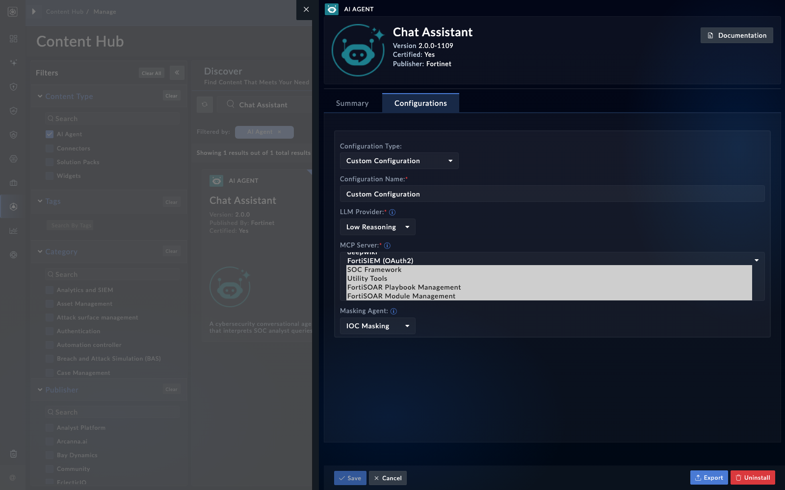

In this page you build a read-only MCP server on your laptop, prove that it speaks the protocol, register it with FortiSOAR, and grant it to one agent with an explicit allowlist. Keep the tool read-only. The lab is about the handshake and the allowlist, not about writing to anything.

## 1. Build a read-only server

The server below exposes one tool that returns a forecast from a fixed table. It makes no network calls, so it works on a laptop with no internet access. The tool is named and typed, and its docstring is what the model reads to decide when to call it.

The import below is for the v1 MCP Python SDK. The v2 SDK renamed `FastMCP` to `MCPServer`, in the module `mcp.server.mcpserver`. Use whichever your SDK installs (NLV-05-09 covers the registration side, and the import path is in the SDK's own docs).

```python
# server.py - read-only lab server, no network calls
from mcp.server.fastmcp import FastMCP

mcp = FastMCP("weather-lab", instructions="Read-only forecast lookups for the lab.")

FORECASTS = {
    "lab-city-a": "Sunny, 21 C",
    "lab-city-b": "Rain, 14 C",
}


@mcp.tool()
def get_forecast(city: str) -> dict:
    """Return the forecast for a known lab city. Read-only."""
    text = FORECASTS.get(city)
    if text is None:
        return {"status": "error", "result": None, "error": "unknown city"}
    return {"status": "ok", "result": text, "error": None}


app = mcp.streamable_http_app()
```

Serve it on localhost with an ASGI server, for example `uvicorn server:app --port 8000`. Bind to localhost only. Put the server behind TLS termination before any other system can reach it.

The tool returns the envelope `status`, `result` and `error`. FortiSOAR agents expect that shape, and some shipped agents break on a bare value (NLV-04-14).

## 2. Prove the handshake with curl

Before FortiSOAR sees the server, check it yourself. The client must send an `Accept` header that lists both JSON and event-stream. The server returns a session ID in the `mcp-session-id` response header, and every later call must send it back.

<!-- step: fsa05-03-handshake manual -->

Send `initialize`. Read the session ID from the response headers. Send `notifications/initialized` with that session header. Then send `tools/list` and `tools/call`.

```bash
# 1. initialize: note the mcp-session-id response header
curl -i -X POST http://localhost:8000/mcp/ \
  -H "Content-Type: application/json" \
  -H "Accept: application/json, text/event-stream" \
  -d '{"jsonrpc":"2.0","id":1,"method":"initialize","params":{"protocolVersion":"<protocol-version-your-sdk-supports>","capabilities":{},"clientInfo":{"name":"curl","version":"0.0.1"}}}'

# 2. tools/list: send the session ID you read above
curl -s -X POST http://localhost:8000/mcp/ \
  -H "Content-Type: application/json" \
  -H "Accept: application/json, text/event-stream" \
  -H "mcp-session-id: <session-id-from-step-1>" \
  -d '{"jsonrpc":"2.0","id":2,"method":"tools/list","params":{}}'
```

**What success looks like**

- The initialize response names the server and includes a session ID.
- The tools list includes `get_forecast` with its input schema.
- A `tools/call` for a known city returns the envelope with the forecast.

A request without the `Accept` header is rejected, so if the call fails with a 406, check that header first (NLV-05-07).

## 3. Register it

Register the server with the steps from the previous page. Validate first, and check that validation returns `get_forecast`. Then persist, note the UUID, and check the status.

Use the `none` authentication type for this lab server only. The URL in the examples, `https://mcp.example.com/mcp/`, is a placeholder for an address the box can reach over HTTPS. A server running on your laptop is not reachable from the box. Your instructor or administrator provides a reachable host. Confirm that the box can reach it and that its certificate is trusted before you validate (NLV-05-04).

## 4. Grant it to one agent with an allowlist

<!-- step: fsa05-04-grant-allowlist manual -->

Pick one agent that can call tools. Add the server's UUID to the agent's allowlist, and list only `get_forecast`. Save the agent configuration. Then ask the agent a question that needs the forecast, and check the trace for the call.

<!-- capture: fsa05-02-agent-allowlist -->


The allowlist behaves in three ways. Know them before you rely on it:

- A server that no agent lists is not filtered for any agent that can see it. A new server is not restricted by existing allowlists, so grant it explicitly (NLV-05-10).
- An agent with no allowlist file gets every tool from every server it is configured with. Always write an explicit allowlist.
- An empty tool list for a server means the agent gets no tools from it.

**What success looks like**

- The agent calls `get_forecast` for a known city and uses the answer.
- Asking for a tool the allowlist does not name returns "not allowed". Ask for one on purpose to see it.

## 5. Optional: break the JSON-string rule on purpose

Only do this on a throwaway non-production box you own. Do not run it on a shared class box.

<!-- step: fsa05-05-json-trap manual -->

Save a second copy of the server's definition, with `authentication` sent as a JSON object instead of a string. Watch the status route. Then fix the row by writing `authentication` back as a string, and check the status again.

**What success looks like**

- You saw the status route fail for every server, not only the broken one.
- After the fix, every server reports its status normally.

{}
Remove the broken copy when you finish. A leftover broken row can make the status route fail for every user of the box.
{}

## Troubleshooting

| Symptom | Likely cause | Fix |
|---|---|---|
| Handshake returns 406 | The `Accept` header lacks event-stream | Send both JSON and event-stream in `Accept` (NLV-05-07) |
| Tool call fails with no session | The `mcp-session-id` header was not sent back | Read it from step 1 and send it on every later call |
| Validation returns no tools | The server did not start, or the URL points elsewhere | Check the server is up, and the URL ends in the path you served |
| Agent says the tool is not allowed | The tool name in the allowlist does not match the server's name | Copy the name from the tools list exactly |
| Agent calls tools you did not grant | No allowlist entry, or the agent has no allowlist file | Write an explicit allowlist with only `get_forecast` (NLV-05-10) |
| Status route fails for every server | A row with `authentication` stored as an object | Rewrite that row's `authentication` as a string (NLV-05-05, NLV-05-06) |
| Tool call times out | The tool is slow, and the platform's call timeout is short | Keep tool responses small and fast. Check the timeout on your build (NLV-05-13). |

<!-- NLV: NLV-04-14, NLV-05-05, NLV-05-06, NLV-05-07, NLV-05-09, NLV-05-10, NLV-05-13 -->
