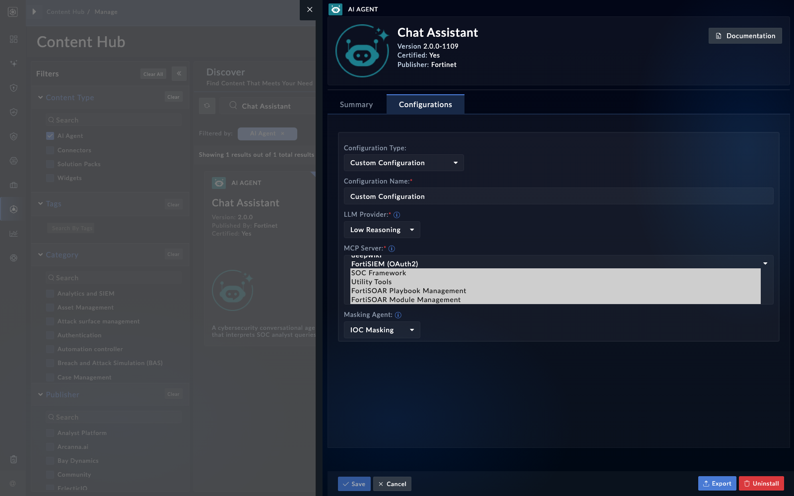

This is the chapter's main lab: take a genuinely remote MCP server, register it with FortiSOAR, grant it to one agent with an explicit allowlist, and prove the agent can use it. In production the remote server is something like FortiSIEM's MCP endpoint; for the lab we use a public server that needs no credentials, so the whole loop runs against nothing but your box and the internet.

## 1. Pick the remote server

| Option | URL | Auth | Use when |
|---|---|---|---|
| DeepWiki (GitHub repo Q&A) | `https://mcp.deepwiki.com/mcp` | `none` | The box has internet reach - the default for this lab |
| A weather MCP server | your instructor provides one | varies | Classes that prefer a weather demo |
| FortiSIEM MCP endpoint | your FortiSIEM's MCP URL | `oauth2` | Your lab has a FortiSIEM - the production shape |

{}
The box itself makes the MCP calls, so the URL must be reachable from the appliance, not from your laptop. A quick reachability check from the appliance CLI: `curl -sI https://mcp.deepwiki.com/mcp` should answer.
{}

## 2. Validate, then register

<!-- step: fsa05-03-register-remote manual: registers a remote server that the box must reach; no spec yet -->

Registration is a validate-then-persist flow: validation performs the real MCP handshake and lists the server's tools without saving anything; only then do you persist the row.

1. Open the AI configuration area and add an MCP server (kind: external).
2. Enter the name (`deepwiki`), transport (`http`), the URL, and authentication type `none`.
3. Run **Validate** first. It must come back listing the server's tools (for DeepWiki: `read_wiki_structure`, `ask_question` and similar).
4. Save, note the server's UUID, and check its status shows healthy.

{}
If your build takes the registration over the API, the `authentication` field must be a JSON string, not an object - an object corrupts the status route for every registered server. The previous page covers the rule and the repair.
{}

## 3. Grant it to one agent

<!-- step: fsa05-04-grant-allowlist manual: edits an agent's configuration; no spec yet and needs an agent that calls tools -->

Pick one agent that calls tools. Open it from **Content Hub** > **AI Agents**, open the agent's detail panel, and switch to the **Configurations** tab. Under a **Custom Configuration** the UI gives that one agent three settings that decide how it behaves:

- **LLM Provider** - the reasoning profile the agent thinks with (for example `Low Reasoning`). This is where you choose the model that answers for this agent.
- **MCP Server** - the servers this agent may reach. Select the one you registered (`deepwiki`) so this agent can call it. Agents can only use servers selected here.
- **Masking Agent** (optional) - a masking agent such as `IOC Masking` that scrubs indicators before data leaves for the LLM.

Select the server, pick an LLM Provider, and **Save**.

The grant is at the server level. Know how reach works before you rely on it:

- The MCP Server field is how an agent is given a server. An agent that does not list a server here cannot call it, however healthy that server is.
- Which tools from a selected server the agent may call is set by the agent's own tool allowlist in its bundle, not in this panel. An agent with no allowlist in its bundle gets every tool from every server selected here, so for anything beyond a lab, pin an explicit allowlist in the bundle.

<!-- capture: fsa05-02-agent-allowlist -->

## 4. Prove it through the agent

<!-- step: fsa05-05-agent-uses-remote manual: an agent call through the remote server; spends tokens -->

Ask the granted agent a question only the remote server can answer (for DeepWiki: "Using your tools, what does the modelcontextprotocol/python-sdk repository say FastMCP is called in v2?"). Then open the agent's trace.

**What success looks like**

- The trace shows a tool call routed to the registered server, and the answer uses its result.
- Asking for a tool the allowlist does not name is refused.
- The server's status page still shows healthy after the calls.

## Troubleshooting

| Symptom | Likely cause | Fix |
|---|---|---|
| Validation finds no tools | The box cannot reach the URL, or the path is wrong | curl the URL from the appliance CLI; the path usually ends in /mcp |
| Validation ok, status failing | `authentication` stored as an object | Rewrite it as a JSON string (previous page) |
| Agent never calls the server | Server not selected for that agent | Select the server in the agent's Configurations tab (MCP Server) and save |
| Calls time out | Slow public server or egress proxy | Retry; check the appliance's proxy settings |

