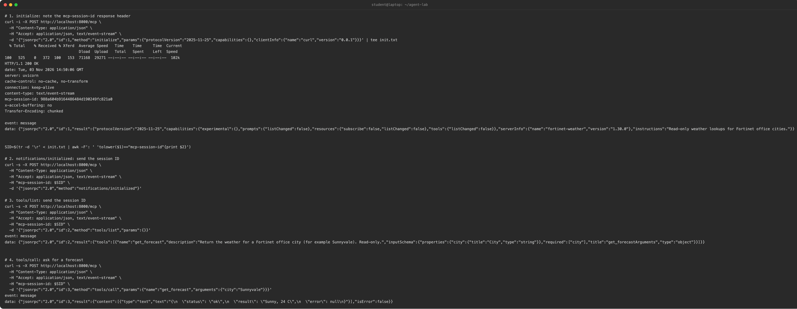

This page is optional. You write a small read-only MCP server, check that it speaks the protocol with curl, and then register it the same way as the DeepWiki server. The tool only reads from a fixed table, so the exercise is about the handshake, not about changing data.

Where to run it:

1. **A lab VM or container that the box can reach.** The server is then a true remote server.
2. **The FortiSOAR appliance itself.** The box can always reach its own localhost, so no TLS or firewall setup is needed. Use this option if your class has no VM.

## 1. Build a read-only server

The server below has one tool, `get_forecast`. It returns a forecast from a fixed table and makes no network calls. The docstring tells the model when to call the tool.

```python
# server.py - read-only lab server, no network calls
from mcp.server.fastmcp import FastMCP

mcp = FastMCP("fortinet-weather", instructions="Read-only weather lookups for Fortinet office cities.")

# Fixed table keyed by Fortinet office city (HQ is Sunnyvale, California).
FORECASTS = {
    "Sunnyvale": "Sunny, 24 C",
    "Ottawa": "Snow, -6 C",
    "Burnaby": "Rain, 11 C",
}

@mcp.tool()
def get_forecast(city: str) -> dict:
    """Return the weather for a Fortinet office city (for example Sunnyvale). Read-only."""
    text = FORECASTS.get(city)
    if text is None:
        return {"status": "error", "result": None, "error": "unknown city"}
    return {"status": "ok", "result": text, "error": None}

app = mcp.streamable_http_app()
```

`requirements.txt` pins the version 1 SDK (`mcp<2`), because `server.py` imports `FastMCP`. Version 2 renamed `FastMCP` to `MCPServer`, in the module `mcp.server.mcpserver`. Only change the import if you move to version 2.

The tool returns `status`, `result` and `error`. FortiSOAR agents expect this shape.

Download the example folder, [`/examples/mcp-servers/weather-lab/`](/examples/mcp-servers/weather-lab/). It holds `server.py`, `requirements.txt` and a `README.md`. Copy the folder to the box, then run these commands in it:

```bash
python3 -m venv .venv && . .venv/bin/activate
pip install -r requirements.txt
uvicorn server:app --host localhost --port 8000
```

Leave the server running. Open a second shell for the curl checks in the next section. Bind to localhost only.

## 2. Check the handshake with curl

<!-- step: fsa05-06-handshake -->

Check the server before FortiSOAR sees it. Every request must send an `Accept` header that lists both JSON and event-stream. The server returns a session ID in the `mcp-session-id` response header. Every later call must send that ID back.

Run these four commands in order. Replace `<protocol-version-your-sdk-supports>` with the protocol version your SDK supports. In the server's venv, `python -c "from mcp.types import LATEST_PROTOCOL_VERSION as v; print(v)"` prints it. Replace `<session-id-from-step-1>` with the value from the first response.

```bash
# 1. initialize: note the mcp-session-id response header
curl -i -X POST http://localhost:8000/mcp \
  -H "Content-Type: application/json" \
  -H "Accept: application/json, text/event-stream" \
  -d '{"jsonrpc":"2.0","id":1,"method":"initialize","params":{"protocolVersion":"<protocol-version-your-sdk-supports>","capabilities":{},"clientInfo":{"name":"curl","version":"0.0.1"}}}'

# 2. notifications/initialized: send the session ID
curl -s -X POST http://localhost:8000/mcp \
  -H "Content-Type: application/json" \
  -H "Accept: application/json, text/event-stream" \
  -H "mcp-session-id: <session-id-from-step-1>" \
  -d '{"jsonrpc":"2.0","method":"notifications/initialized"}'

# 3. tools/list: send the session ID
curl -s -X POST http://localhost:8000/mcp \
  -H "Content-Type: application/json" \
  -H "Accept: application/json, text/event-stream" \
  -H "mcp-session-id: <session-id-from-step-1>" \
  -d '{"jsonrpc":"2.0","id":2,"method":"tools/list","params":{}}'

# 4. tools/call: ask for a forecast
curl -s -X POST http://localhost:8000/mcp \
  -H "Content-Type: application/json" \
  -H "Accept: application/json, text/event-stream" \
  -H "mcp-session-id: <session-id-from-step-1>" \
  -d '{"jsonrpc":"2.0","id":3,"method":"tools/call","params":{"name":"get_forecast","arguments":{"city":"Sunnyvale"}}}'
```

**You are done when**

- The initialize response names the server and includes a session ID.
- The tools list includes `get_forecast` with its input schema.
- The `tools/call` response returns the envelope with the Sunnyvale forecast.

<!-- capture: fsa05-06-handshake-curl -->


## 3. Register it and grant it

Register the server as you did the DeepWiki server. On the MCP Servers page, click **Connect MCP Server** and fill in the form:

- **Server Name:** `weather-lab`
- **Transport Type:** **http**
- **URL:** `http://localhost:8000/mcp`
- **Authentication > Type:** **None**

Click **Test Connection**. It must list `get_forecast`. Then click **Save** and check the status.

Use **None** for this lab server only. A server on your laptop is not reachable from the box. That is why this lab runs the server on the appliance. If your class gives you a shared host instead, check that the box can reach it and that its certificate is trusted before you test.

Grant the server to one agent, as on the previous page. To limit the agent to `get_forecast`, add an allowlist with only that tool to the agent's bundle. Then ask the agent: `What is the forecast for Sunnyvale? Use your tools.` Check the trace for the `get_forecast` call.

## 4. Optional: break the JSON-string rule on purpose

Only do this on a throwaway box that you own. Never do it on a shared class box.

The `authentication` field must be sent as a JSON string, not as a JSON object. If you send an object, the platform stores the text **Array** in its place. Then the status route fails for every registered MCP server, not just the one you got wrong.

Wrong, because the value is an object:

```json
"authentication": {"type": "none"}
```

Right, because the value is the same JSON, serialized as a string:

```json
"authentication": "{\"type\": \"none\"}"
```

<!-- step: fsa05-07-json-trap manual: breaks the JSON rule on purpose on a throwaway box; the page forbids it on a shared box -->

Send a second copy of the server's definition, with `authentication` written as the JSON object shown above. Watch the status route. Then fix the row by writing `authentication` back as a string, and check the status again.

**You are done when**

- You saw the status route fail for every server, not only the broken one.
- After the fix, every server reports its status normally.

{}
Remove the broken copy when you finish. A leftover broken row can make the status route fail for every user of the box.
{}

## Troubleshooting

| Symptom | Likely cause | Fix |
|---|---|---|
| Handshake returns 406 | The `Accept` header lacks event-stream | Send both JSON and event-stream in `Accept` |
| Tool call fails with no session | The `mcp-session-id` header was not sent back | Read it from the initialize response and send it on every later call |
| Validation returns no tools | The server is not running, or the URL is wrong | Check that uvicorn is still running, and that the URL ends in `/mcp` |
| Agent says the tool is not allowed | The tool name in the allowlist does not match the server's name | Copy the name from the tools list exactly |
| Agent calls tools you did not grant | No allowlist, or the allowlist is missing | Write an allowlist with only `get_forecast` |
| Status route fails for every server | A row has `authentication` stored as an object | Rewrite that row's `authentication` as a string, as in section 4 |
