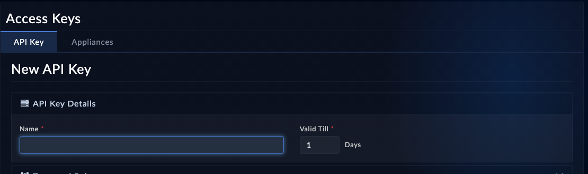

The agent authenticates to FortiSOAR with an API key. Create a dedicated one so you can see the agent's actions in the audit log and revoke it independently of your own login.

## 1. Create the key

<!-- step: fsa06-01-create-api-key manual: creates an access key in the UI; no spec yet -->

1. Log in to your FortiSOAR instance at `https://fortisoar.example.com`.
2. Open **System** > **Identity & Access Management** > **Access Keys**, on the **API Key** tab. Some versions name the tab or menu differently.
3. Click **Add**, name it `agentlab key`, and assign a role with enough rights for the whole workshop. The labs do more than read and write records: chapter 7 **creates a module** (a schema change), chapter 9 **installs a connector**, and chapter 8 **publishes a playbook**. **Full App Permissions** alone covers record CRUD but not those, so pair it with **Application Administrator** (module schema and connectors), **Security Administrator** (roles and access), and **Playbook Administrator** (playbook publish) - or use a role your instructor confirms can manage modules, connectors and playbooks. In production, scope this down.

> Operators: `tools/lab_setup.py grant` unions exactly those three roles onto the key's role from an admin login, so you do not have to click through the UI. See `tools/LAB_OPERATOR.md`.
4. Set **Valid Till**. The form defaults to **1 day**, and a key that expires mid-class fails every later step. Set a period that covers the session.
5. Save, then copy the key value.

<!-- capture: fsa06-01-api-key-page -->

{}
Treat the key like a password. It goes into your agent's MCP configuration and nowhere else: not into a git repo, not into a prompt, not into a chat transcript you might share.
{}

## 2. What success looks like

The key appears in the API Keys list with your chosen role. Keep the value handy for the next page.

## Troubleshooting

| Symptom | Likely cause | Fix |
|---|---|---|
| No API Keys page under Settings | Your login lacks the Security read permission | Use an admin account or ask your instructor |
| Key works for reads but writes return 403 | The key's role lacks Create/Update on the module | Edit the role, or assign Full App Permissions for the lab |
| Creating a module returns 403 on `staging_model_metadatas` | The role has record CRUD but not module-schema rights | Add **Application Administrator** (Application Editor rights) to the key's role; Full App Permissions alone is not enough |
