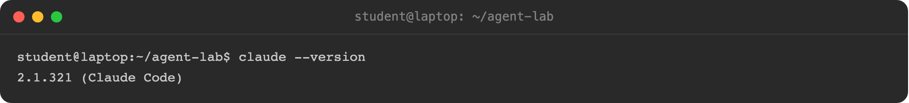
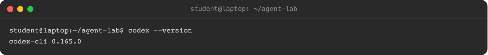
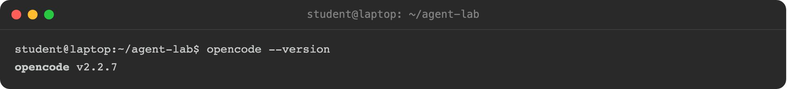

The toolkit works with coding agents that support MCP. This workshop is tested with **Claude Code**, **Codex**, **OpenCode** and **FortiAgent**, Fortinet's desktop agent. Install one of them. You need only one.

You need a terminal, and an account that the agent can sign in with, such as a subscription or an API key from the vendor. FortiAgent signs in with your FortiCloud account instead. The agent uses tokens while it works.

{}
{}
Install on macOS, Linux or WSL:

```bash
curl -fsSL https://claude.ai/install.sh | bash
```

On Windows, in PowerShell:

```powershell
irm https://claude.ai/install.ps1 | iex
```

Homebrew (`brew install --cask claude-code`) and WinGet (`winget install Anthropic.ClaudeCode`) also work. Homebrew installs do not update themselves.

Check it:

```bash
claude --version
```

Start it in an empty working folder and sign in when asked:

```bash
mkdir fsr-agent-lab && cd fsr-agent-lab
claude
```

The first time you open a folder, Claude Code asks whether you trust it. Choose yes. Otherwise it ignores the `.mcp.json` file that you add on the next page.

<!-- step: fsa06-01a-claude-version -->
<!-- capture: fsa06-01a-claude-version -->


Trouble installing or signing in? See Anthropic's [setup guide](https://code.claude.com/docs/en/setup) and [troubleshooting page](https://code.claude.com/docs/en/troubleshooting).
{}
{}
Install on macOS or Linux:

```bash
curl -fsSL https://chatgpt.com/codex/install.sh | sh
```

On Windows, in PowerShell:

```powershell
powershell -ExecutionPolicy ByPass -c "irm https://chatgpt.com/codex/install.ps1 | iex"
```

npm (`npm install -g @openai/codex`) and Homebrew (`brew install --cask codex`) also work, or download a binary from the [latest GitHub release](https://github.com/openai/codex/releases/latest).

Check it:

```bash
codex --version
```

Run `codex` once and sign in when asked. Codex keeps its settings in `~/.codex/config.toml`. The next page adds FortiSOAR there.

<!-- step: fsa06-01a-codex-version -->
<!-- capture: fsa06-01a-codex-version -->


Trouble installing or signing in? See OpenAI's [Codex CLI docs](https://developers.openai.com/codex/cli) and the [Codex repository](https://github.com/openai/codex).
{}
{}
Install on macOS or Linux:

```bash
curl -fsSL https://opencode.ai/install | bash
```

npm (`npm install -g opencode-ai`) and Homebrew (`brew install opencode`) also work. On Windows, use `scoop install opencode`, `choco install opencode`, or npm.

Check it:

```bash
opencode --version
```

Run `opencode` in your working folder and connect a model provider when asked. OpenCode reads `opencode.json` from the project folder. The next page adds FortiSOAR there.

In OpenCode 2, the FortiSOAR tools appear as `tools.fortisoar.<tool>` inside `execute`, not as separate tool names.

<!-- step: fsa06-01a-opencode-version -->
<!-- capture: fsa06-01a-opencode-version -->


Trouble installing or connecting a provider? See the [OpenCode docs](https://opencode.ai/docs/) and its [troubleshooting page](https://opencode.ai/docs/troubleshooting/).
{}
{}
FortiAgent is a desktop app for macOS. It chats through **FortiAI**, Fortinet's hosted model, and signs in with your FortiCloud account, so there is no API key to paste.

Install it in **Terminal**:

```bash
curl -fsSL --proto '=https' --tlsv1.2 https://fortiagent.fortinet.com/downloads/fortiagent/install.sh | bash
```

The installer checks the release's checksum before it installs anything. You can also download the `.dmg` from the FortiAgent portal's **Install** page and drag **FortiAgent** to **Applications**.

Open **FortiAgent** from **Applications**. The first launch shows a setup screen. Click **Sign in to use FortiAI**, sign in with FortiCloud in the browser that opens, and allow FortiAgent. The app moves to the chat on its own. An account with no FortiAgent Desktop license stops at **FortiAgent needs a FortiAgent Desktop license**. Tell your instructor.

Check it: open **Settings** with the gear at the bottom of the sidebar. The **FortiAI** card reads **ready**.

<!-- step: fsa06-14-fortiagent-ready -->
<!-- capture: fsa06-14-fortiagent-ready -->

In a terminal, `fortiagent service status` shows the same signed-in state.

For each screen in detail, see the **Install and Sign In** chapter of the FortiAgent workshop.
{}
{}

**You are done when:** the version command prints a version number (for FortiAgent, the FortiAI card reads **ready**), and the agent starts and answers a plain question such as "what folder are you in?".

## Troubleshooting

| Symptom | Likely cause | Fix |
|---|---|---|
| `command not found` after install | The install folder is not on your `PATH` | Open a new terminal, or add the folder that the installer printed to `PATH` |
| The installer fails on a corporate network | A proxy or TLS inspection blocks the download | Use your package manager (npm, Homebrew, WinGet), or see the vendor's troubleshooting page linked in your agent's tab |
| The agent starts but sign-in fails | No subscription or API key on the account | Follow the vendor's sign-in steps; the links are at the end of each tab |

Next, point the agent at FortiSOAR.
