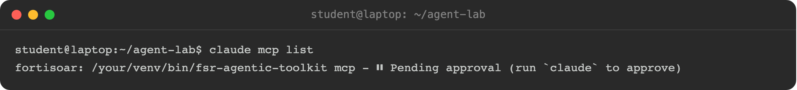
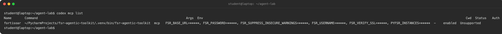

Your agent connects to FortiSOAR through the `fsr-agentic-toolkit` MCP server. You need the box URL and the login from the previous page.

## 1. Install the toolkit

<!-- step: fsa06-02-install-tooling manual: installs tooling on the learner workstation, not on the box -->

You need Python 3.10 or later, and [uv](https://docs.astral.sh/uv/) or pip. Then run:

```bash
pip install "fsr-agentic-toolkit==0.2.3"
```

## 2. Generate the MCP config

Run this command. Leave out `--password`. The toolkit then prompts for the password, so it stays out of your shell history.

```bash
fsr-agentic-toolkit init --url fortisoar.example.com --username '<login-id>' --no-verify-ssl
```

Replace the URL and the login id with yours. `--no-verify-ssl` trusts the self-signed certificate of a lab box.

`init` checks the connection, then prints the config snippet for your agent:

```text
connected: agentlab <admin@example.com> @ fortisoar.example.com
--- claude-code ---
# .mcp.json (project root), or merge into ~/.claude.json
{
  "mcpServers": {
    "fortisoar": {
      "command": "/your/venv/bin/fsr-agentic-toolkit",
      "args": [
        "mcp"
      ],
      "env": {
        "FSR_BASE_URL": "fortisoar.example.com",
        "FSR_USERNAME": "agentlab",
        "FSR_PASSWORD": "<your-password>",
        "FSR_VERIFY_SSL": "false",
        "FSR_SUPPRESS_INSECURE_WARNINGS": "true"
      }
    }
  }
}
```

<!-- step: fsa06-02-init-output -->
<!-- capture: fsa06-02-init-output -->


It also prints safety notes and a short guide for the agent. You only need the JSON block. The snippet holds your password, so keep the file out of shared folders and version control.

The `connected:` line names the login the agent signs in as. If that line does not appear, check the URL and the login. No snippet is printed.

## 3. Add the snippet to your agent

You do not start the toolkit yourself. The snippet tells your agent how to: `command` is the toolkit program in your Python environment, `args` (`mcp`) makes it run as an MCP server, and `env` passes it your box URL, login and password. When the agent starts, it launches that program in the background and talks to it directly. Each agent reads the snippet from its own config file.

{}
{}
Claude Code reads its MCP servers from `.mcp.json` in the folder where you start `claude`.

1. In the folder you made on the previous page, save the printed JSON block as `.mcp.json`. To print it again, run the section 2 command with `--claude-code` added.
2. Still in your shell, run `claude mcp list`. It also checks the file: if the JSON is broken, it prints `[Failed to parse]` with the file name. A good file shows `fortisoar` as `Pending approval`.

   <!-- step: fsa06-03-claude-mcp-list -->
   <!-- capture: fsa06-03-claude-mcp-list -->
   

3. Start `claude` in that folder. Approve the `fortisoar` server when asked.
4. Type `/mcp`. The `fortisoar` server should show as connected, with its tools listed.

<!-- step: fsa06-03-agent-init -->
<!-- capture: fsa06-03-agent-init -->


{}
{}
Codex reads its MCP servers from `~/.codex/config.toml`.

1. In your shell, run the section 2 command again with `--codex` added. Use your own URL and login id; it prompts for the password.

   ```bash
   fsr-agentic-toolkit init --url fortisoar.example.com --username '<login-id>' --no-verify-ssl --codex
   ```

   It prompts for your password, checks the login, then prints the Codex config. Your password is written into the `env` table, which is how Codex's copy of the toolkit signs in:

   ```toml
   [mcp_servers.fortisoar]
   command = "/your/venv/bin/fsr-agentic-toolkit"
   args = ["mcp"]
   startup_timeout_sec = 60

   [mcp_servers.fortisoar.env]
   FSR_BASE_URL = "fortisoar.example.com"
   FSR_USERNAME = "agentlab"
   FSR_PASSWORD = "<your-password>"
   FSR_VERIFY_SSL = "false"
   FSR_SUPPRESS_INSECURE_WARNINGS = "true"
   ```

   Copy both tables into `~/.codex/config.toml`, creating the file if it does not exist. `startup_timeout_sec = 60` is there because a first start can take longer than Codex's 10-second default. The file holds your password, so do not share it or commit it.
2. Still in your shell, not inside Codex, run `codex mcp list`. It also checks the file: if the TOML is broken, it prints the line and column to fix instead of the table. The `fortisoar` row should read `enabled`. For a full check of the Codex setup, run `codex doctor` and look for `✓ config loaded`.

<!-- step: fsa06-12-codex-mcp-list -->
<!-- capture: fsa06-12-codex-mcp-list -->


3. In the lab folder, start `codex`. If it shows an update prompt, press **Esc** to skip it. Do not press Enter there. Its first choice is "Update now".
4. In Codex, type `/mcp`. Wait for `fortisoar: connected (N tools)`. Then type `/new` to start a fresh chat. Codex gives a chat the server's tools only when that chat starts.

   <!-- step: fsa06-12b-codex-mcp-connected -->
   <!-- capture: fsa06-12b-codex-mcp-connected -->
   

{}
{}
1. Run the `init` command with `--opencode`. Merge the printed `mcp` block into the `opencode.json` file in your project folder.
2. Restart OpenCode in the project.
3. Ask it to list its tools. The FortiSOAR tools should appear. In OpenCode 2 they appear inside `execute` as `tools.fortisoar.<tool>`.
{}
{}
FortiAgent keeps its MCP servers in its own settings. You add the toolkit in the app with the same values that the `init` snippet printed.

1. Find the toolkit's full path. FortiAgent searches only the standard folders for a bare name, so a full path always works:

   ```bash
   which fsr-agentic-toolkit
   ```

2. Open **Settings > MCP servers** and click **Add an MCP server**. Pick **Local command**.
3. **Name:** `FortiSOAR`.
4. **Command:** the full path from step 1, the snippet's `command`.
5. **Arguments:** `mcp` on the first line.
6. **Environment variables:** add each `env` entry from the snippet: `FSR_BASE_URL`, `FSR_USERNAME`, `FSR_PASSWORD`, `FSR_VERIFY_SSL` (`false`) and `FSR_SUPPRESS_INSECURE_WARNINGS` (`true`). FortiAgent stores every value encrypted and never shows it again.
7. Click **Add server**.

<!-- step: fsa06-15-fortiagent-add-mcp-form -->
<!-- capture: fsa06-15-fortiagent-add-mcp-form -->

From a shell, the same thing is:

```bash
fortiagent mcp add FortiSOAR \
  --env FSR_BASE_URL=fortisoar.example.com \
  --env FSR_USERNAME=agentlab \
  --env FSR_PASSWORD='<your-password>' \
  --env FSR_VERIFY_SSL=false \
  --env FSR_SUPPRESS_INSECURE_WARNINGS=true \
  -- /your/venv/bin/fsr-agentic-toolkit mcp
```

8. Open a **New chat**, so the engine starts the server. Back in **Settings > MCP servers**, the `FortiSOAR` row shows a green dot when it is connected. Hover over a dot that is not green for the reason. In a shell, `fortiagent mcp list` shows `connected`.

<!-- step: fsa06-16-fortiagent-mcp-list -->
<!-- capture: fsa06-16-fortiagent-mcp-list -->

For the status dots and reloading, see the **MCP Servers** chapter of the FortiAgent workshop.
{}
{}

## 4. Install the skills

The toolkit ships short skills. They teach the agent good habits, such as checking a playbook before it publishes, reading every write back, and keeping secrets out of the chat. Install them in the lab folder.

{}
{}
```bash
fsr-agentic-toolkit skills --install
```

Restart `claude`. The skills load from `.claude/skills`.
{}
{}
```bash
fsr-agentic-toolkit skills --install --agents-md AGENTS.md
```

This adds a block to `AGENTS.md` that points the agent at each skill.
{}
{}
Skip this step. FortiAgent does not read `.claude/skills` or `AGENTS.md`, so `fsr-agentic-toolkit skills --install` changes nothing for it. FortiAgent's own **Skills** (in the sidebar) come from its skills marketplace, and none ship for this toolkit. The toolkit's tool descriptions still steer FortiAgent, and its approval card still guards every write.
{}
{}

## 5. First contact

<!-- step: fsa06-04-whoami-claude -->

Give your agent this prompt:

```text
In one short paragraph: who am I on this FortiSOAR box, and what can you help
me do here?
```

The agent calls `whoami`. It answers with your login id and the box version. `whoami` only reads, so nothing on the box changes. Every write that you allow later runs under this login, and the audit log records it under this login.

<!-- capture: fsa06-04-whoami-claude -->


Codex answers the same way. It shows the `whoami` call as it runs, then the answer:

<!-- step: fsa06-13-codex-whoami -->
<!-- capture: fsa06-13-codex-whoami -->


In FortiAgent, open a **New chat** and ask in plain words:

```text
Who am I logged in as on FortiSOAR, and what version is the box?
```

FortiAgent picks the `whoami` tool on its own and answers with your login id and the box version. A tool that only reads runs with no approval card.

<!-- step: fsa06-17-fortiagent-whoami -->
<!-- capture: fsa06-17-fortiagent-whoami -->

OpenCode works the same way:

<!-- step: fsa06-08-opencode-setup manual: runs a read-only whoami turn in OpenCode; spends tokens -->
<!-- capture: fsa06-08-opencode-setup -->


Now give it real work. Give your agent this prompt:

```text
List the modules on this box, then show me the few newest alerts, with one
line on what stands out about each.
```

The agent calls `list_modules`, reads the newest alerts, and gives a short summary. The agent now reads the box, and nothing has changed.

## Troubleshooting

| Symptom | Fix |
|---|---|
| The agent says it has no `fortisoar` tools | The MCP config is not loaded. In Claude Code, `.mcp.json` must be in the folder where you started `claude`. Run `/mcp` to check. |
| Tools are listed, but every call fails to connect | Your workstation cannot reach the box. Run `curl -k https://fortisoar.example.com` from the same machine. |
| Codex says the `fortisoar` tools are not available | Codex started the chat before the server connected. Type `/mcp` and wait for `fortisoar: connected`. Then type `/new` and ask again. |
