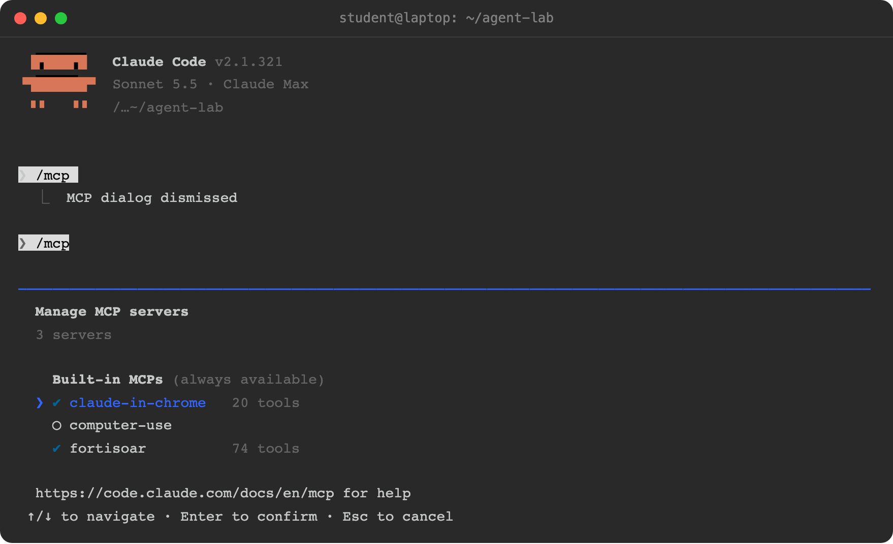
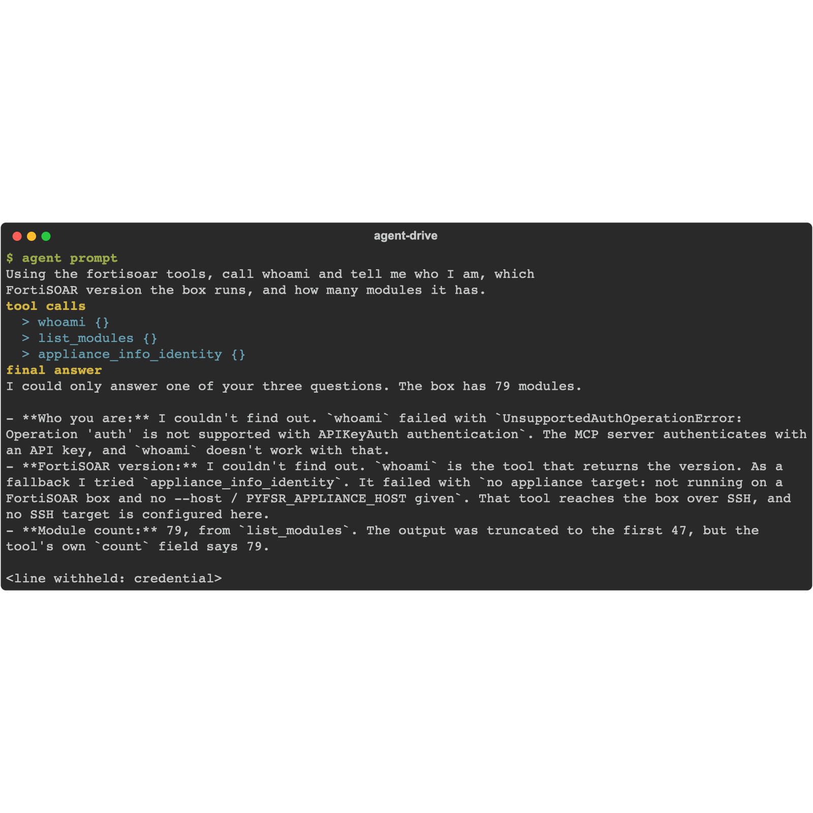

Your agent talks to FortiSOAR through the `fsr-agentic-toolkit` MCP server, which builds on the open-source [pyfsr](https://github.com/ftnt-dspille/pyfsr) SDK. It needs two values: the box URL and the API key from the previous page.

## 1. Install the tooling

<!-- step: fsa06-02-install-tooling manual: installs tooling on the learner workstation, not on the box -->

You need Python 3.10+ and [uv](https://docs.astral.sh/uv/) (or pip). Then:

```bash
pip install fsr-agentic-toolkit
```

This also installs `pyfsr`, whose `pyfsr connector` commands you use in chapter 9.

## 2. Generate your agent's MCP config

<!-- step: fsa06-03-agent-init manual: starts Claude Code on the workstation against the agent; spends tokens -->

`fsr-agentic-toolkit init` checks the box and prints the config snippet for your agent product:

```bash
fsr-agentic-toolkit init --url fortisoar.example.com --api-key '<your-api-key>' --no-verify-ssl --skip-verify
```

You should see:

```text
--- claude-code ---
# .mcp.json (project root), or merge into ~/.claude.json
{ ... }
```

<!-- capture: fsa06-03-agent-init -->


{}
`--skip-verify` is needed with an API key: the connection check calls an auth probe that API-key logins do not support, so `init` reports that it could not verify and prints the snippet anyway. You prove the connection in step 4 with whoami instead.

`--no-verify-ssl` is for lab boxes with self-signed certificates. Add `--readonly` to start the agent with a read-only tool surface; you can remove it after chapter 6.
{}

## 3. Install the snippet

{}
{}
1. Make a working folder for the lab (`mkdir fsr-agent-lab && cd fsr-agent-lab`).
2. Save the printed snippet as `.mcp.json` in that folder (re-run `init` with `--claude-code` to print it again).
3. Start `claude` in the folder and approve the new MCP server when prompted.
4. Type `/mcp` to confirm the `fortisoar` server is connected and its tools are listed.
{}
{}
1. Run `fsr-agentic-toolkit init ... --opencode` and merge the printed `mcp` block into your project's `opencode.json`.
2. Restart OpenCode in the project.
3. Ask it to list its tools; the FortiSOAR tools should appear.
{}
{}
1. Run `fsr-agentic-toolkit init ... --copilot` and save the snippet as `.vscode/mcp.json`.
2. In VS Code, open Copilot Chat in agent mode and start the server when prompted.
3. The tool picker should list the FortiSOAR tools.
{}
{}

## 4. First contact: whoami

Give your agent this prompt:

```text
Using the fortisoar tools, call whoami and tell me who I am, which
FortiSOAR version the box runs, and how many modules it has.
```

<!-- step: fsa06-04-whoami -->

**What success looks like:** the agent reports your login id, the box version (8.0.1 or later) and a module count around 40. On the box, nothing changed: whoami and list_modules are read-only.

<!-- capture: fsa06-04-whoami-claude -->


## Troubleshooting

| Symptom | Likely cause | Fix |
|---|---|---|
| `init` fails with a certificate error | Self-signed box certificate | Add `--no-verify-ssl` |
| `init` fails with 401 | Wrong or truncated API key | Re-copy the key; check for trailing whitespace |
| Agent says it has no fortisoar tools | MCP config not loaded | Claude Code: `.mcp.json` must be in the folder you started `claude` in; check `/mcp` |
| Tools listed but every call fails with a connection error | Workstation cannot reach the box | `curl -k https://fortisoar.example.com` from the same machine |
| whoami works but the agent picks odd tools | Tool surface too wide for the task | Add `FSR_MCP_DENY_TOOLS=appliance_*` to the env block |

<!-- agent-drive:begin -->

<details><summary>What the agent did</summary>

**`02-wire-the-agent#1`** (Sonnet run, sanitized)


```text
  > whoami {}
  > list_modules {}
  > appliance_info_identity {}
```

</details>

<!-- agent-drive:end -->
