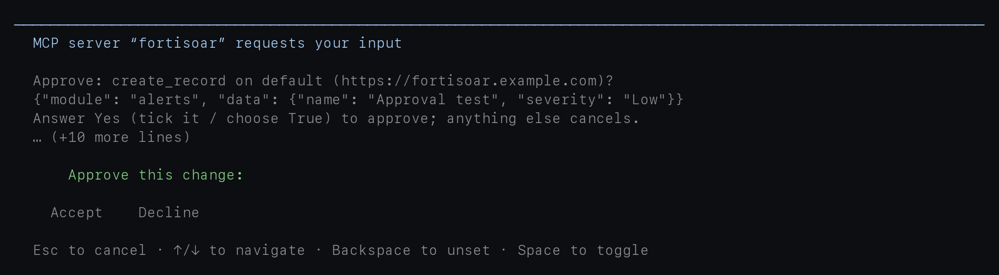
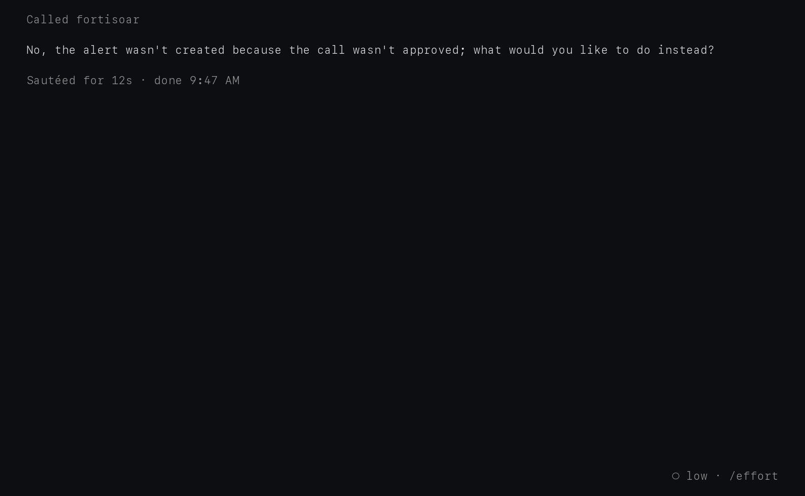
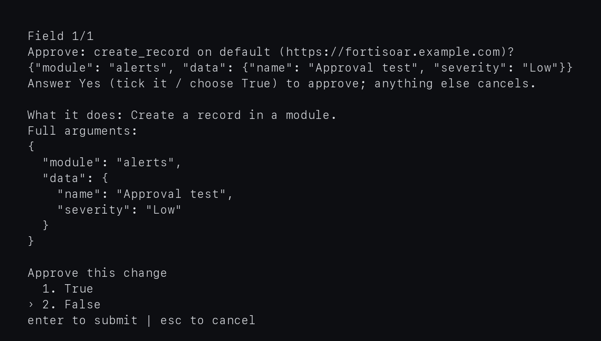
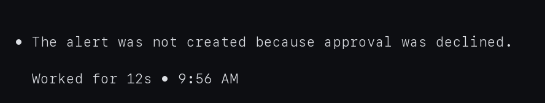
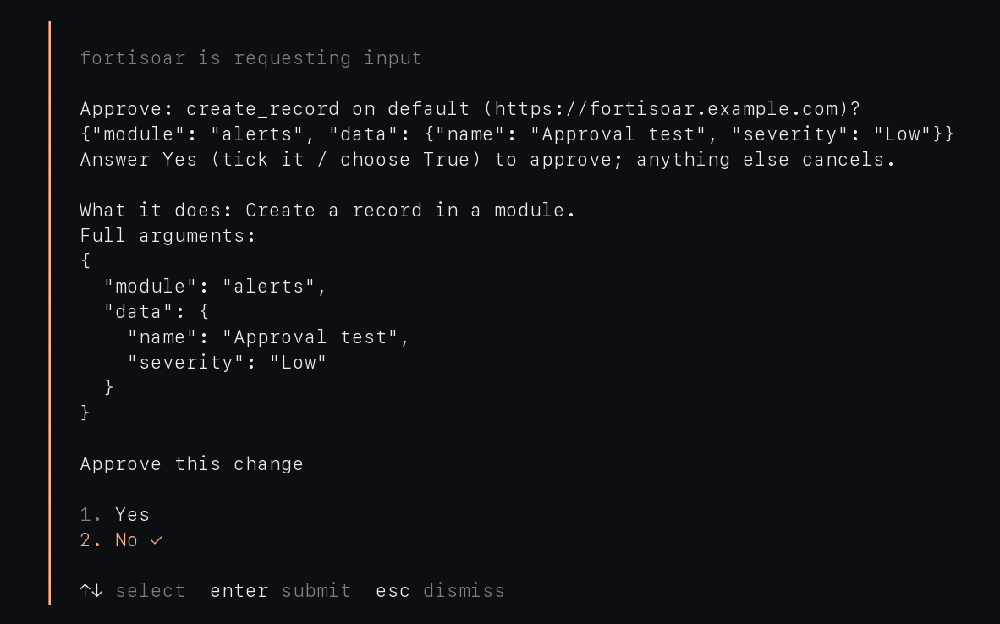

By default an agent can change FortiSOAR as freely as you could: create records, publish playbooks, configure connectors. The toolkit puts a human in that path. Before any write runs, the server asks **you** to approve it, through your coding agent's own interface. Reads never prompt.

## 1. What you will see

When the agent decides to change something, an approval prompt appears in your terminal or editor. It shows:

- the **box** the change will hit,
- the **tool** and what it does,
- the **arguments**, with anything that looks like a password, key or token masked.

Say no, and nothing happens. The agent is told you declined and not to retry the same call, so it asks you what you want instead.

## 2. Try it

Give your agent this prompt:

```text
Create an alert named "Approval test" with severity Low, then tell me whether
you were asked first.
```

**What success looks like:** a prompt appears before the alert exists. Approve it and the alert is created; decline it and the agent reports that you said no. Delete the test alert afterwards.

Then ask it to list the alerts. No prompt appears: reads are never interrupted.

### What each agent shows

| Agent | What you see | How to approve |
|---|---|---|
| Claude Code | "requests your input", with the box, tool and arguments, a checkbox and Accept / Decline | Tick the box, then choose Accept |
| Codex | The same text, with "Approve this change" as `1. True` / `2. False` (False is preselected) | Choose True, press Enter |
| OpenCode | "fortisoar is requesting input", with `1. Yes` / `2. No` (No is preselected) | Choose Yes, press Enter |

{}
{}


After declining:


{}
{}


After declining:


{}
{}

{}
{}

Choosing Accept without ticking the box, pressing Escape, or letting it time out all count as no.

## 3. The setting

`FSR_MCP_APPROVAL` goes in the same `env` block as the connection settings:

| Value | Behavior |
|---|---|
| `auto` (default) | Ask when your coding agent can show a prompt; otherwise run the write and rely on the agent's own tool prompts |
| `require` | Ask, and refuse the write if your agent cannot show a prompt |
| `off` | Never ask. For unattended runs only. |

If nobody answers within five minutes (`FSR_MCP_APPROVAL_TIMEOUT`, in seconds), the write is refused, so an unattended run can never hang or write by accident.

Use `require` if you need a guarantee that no write ever runs without a person saying yes.

## 4. If your agent does not show the prompt

Coding agents differ in what they support. If you are in `auto` mode and a write runs without a prompt, your agent does not support the server's approval requests. You have two fallbacks:

- **Set `require`.** Writes are then refused rather than run unasked, which is safe but means this agent cannot write.
- **Use the agent's own tool approvals.** Every tool is marked read-only or not, so a client that honors those hints will ask for the writes on its own. In Claude Code you can also generate explicit rules, reads allowed and writes asking:

```bash
fsr-agentic-toolkit permissions --write .claude/settings.json
```

It merges into your existing settings and removes nothing you already have.

{}
The prompt looks different in each agent. We checked Claude Code 2.1.312, Codex 0.165.0 and OpenCode 2.2.0, and all three show it. Do the test in section 2 with your own agent before relying on it, especially if it is not one of these.
{}

## Troubleshooting

| Symptom | Likely cause | Fix |
|---|---|---|
| A write ran with no prompt | `auto` mode and your agent cannot show the prompt | Set `FSR_MCP_APPROVAL=require`, or use the agent's own tool approvals |
| Every write is refused with "this client cannot ask the user" | `require` mode with an agent that cannot prompt | Switch to `auto` and use the agent's tool approvals |
| The agent keeps retrying after you decline | It ignored the "do not retry" instruction | Tell it plainly to stop, and report the agent |
| You are asked about something that is not a change | A tool that reads was marked as a write | Report it; reads should never prompt |
