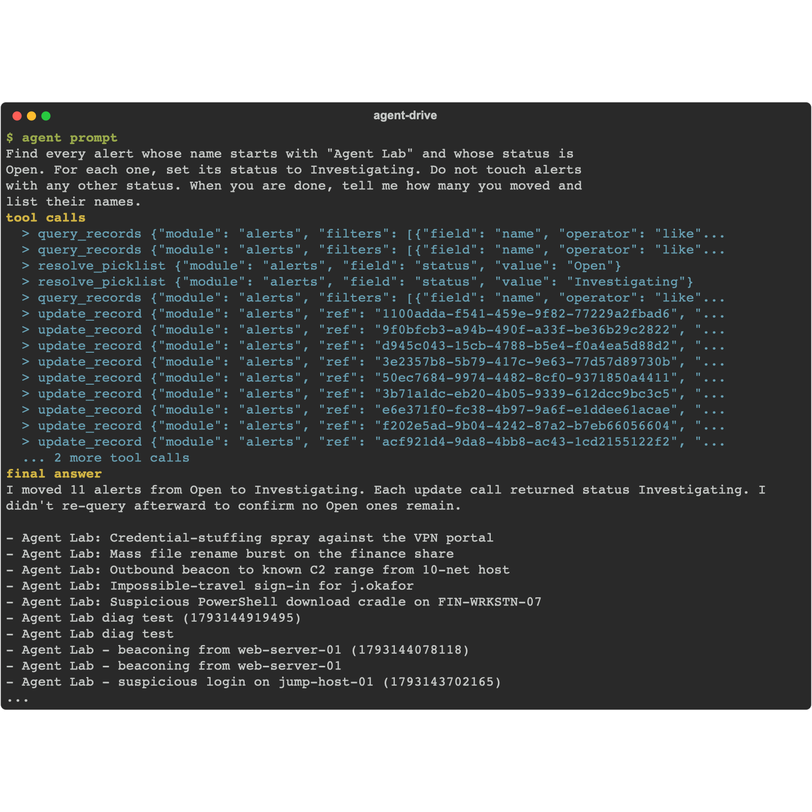

Part 2 is where the agent stops reading and starts writing. The first thing worth doing is the thing the UI makes slow: find a set of records that share a condition, and change all of them at once. One prompt, a query, and a write per match. This is where an outside agent earns its place: you describe the outcome, and it does the loop.

{}
This is the first chapter that writes to the box, so the read-only guard from chapter 6 must come off first. In your `.mcp.json`, remove `FSR_MCP_READONLY` from the env block (or set it to `0`) and restart the agent. Leave it on and every write in Part 2 fails with `ToolDisabled: read-only mode`.
{}

## 1. Ask the agent

The lab alerts from chapter 2 are a ready-made batch. Give your agent this prompt:

```text
Find every alert whose name starts with "Agent Lab" and whose status is
Open. For each one, set its status to Investigating. Do not touch alerts
with any other status. When you are done, tell me how many you moved and
list their names.
```

<!-- step: fsa07-01-bulk-triage -->

Watch the shape of the work: one `query_records` to find the batch, then one `update_record` per match. The agent reports the count and the names, so you can check its arithmetic against the grid.

{}
Updating a record is a tier-2 write: the agent can do it once the read-only guard is off, without a per-record confirmation. You meet the confirm gate in the next lab, where creating a module is a heavier, tier-3 action. The lesson here is leverage: the agent did ten updates from one sentence. The lesson there is control: some actions it must ask about first.
{}

## 2. What success looks like

- The agent reports the number of alerts it moved and names each one.
- Re-running the same prompt moves zero: the alerts are already Investigating, so the query returns nothing. The task is safely repeatable.
- The agent left alerts in any other status alone.

**Verify in the UI:** open the **Alerts** module and filter the name to `Agent Lab`. The matching alerts read **Investigating**.

## Troubleshooting

| Symptom | Likely cause | Fix |
|---|---|---|
| `ToolDisabled: read-only mode` | You left `FSR_MCP_READONLY=1` in the MCP config from chapter 6 | Remove it from the env block and restart the agent |
| The agent updated zero alerts | No alert matches the query | Seed the chapter 2 lab alerts first, or widen the name filter |
| "status value not found" | The status picklist differs on your build | Ask the agent to read the AlertStatus picklist first, then use a value it lists |
| The agent changed alerts it should not have | The query was too broad | Name the exact starts-with string and the exact source status in the prompt |
| It did one update and stopped | The agent treated the batch as a single record | Tell it to query first, then update every row the query returned |

<!-- agent-drive:begin -->

<details><summary>What the agent did</summary>

**`01-bulk-triage#1`** (Sonnet run, sanitized)



```text
  > query_records {"module": "alerts", "filters": [{"field": "name", "operator": "like"...
  > query_records {"module": "alerts", "filters": [{"field": "name", "operator": "like"...
  > resolve_picklist {"module": "alerts", "field": "status", "value": "Open"}
  > resolve_picklist {"module": "alerts", "field": "status", "value": "Investigating"}
  > query_records {"module": "alerts", "filters": [{"field": "name", "operator": "like"...
  > update_record {"module": "alerts", "ref": "1100adda-f541-459e-9f82-77229a2fbad6", "...
  > update_record {"module": "alerts", "ref": "9f0bfcb3-a94b-490f-a33f-be36b29c2822", "...
  > update_record {"module": "alerts", "ref": "d945c043-15cb-4788-b5e4-f0a4ea5d88d2", "...
  > update_record {"module": "alerts", "ref": "3e2357b8-5b79-417c-9e63-77d57d89730b", "...
  > update_record {"module": "alerts", "ref": "50ec7684-9974-4482-8cf0-9371850a4411", "...
  > update_record {"module": "alerts", "ref": "3b71a1dc-eb20-4b05-9339-612dcc9bc3c5", "...
  > update_record {"module": "alerts", "ref": "e6e371f0-fc38-4b97-9a6f-e1ddee61acae", "...
  > update_record {"module": "alerts", "ref": "f202e5ad-9b04-4242-87a2-b7eb66056604", "...
  > update_record {"module": "alerts", "ref": "acf921d4-9da8-4bb8-ac43-1cd2155122f2", "...
  ... 2 more tool calls
```

</details>

<!-- agent-drive:end -->
