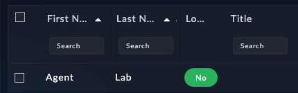
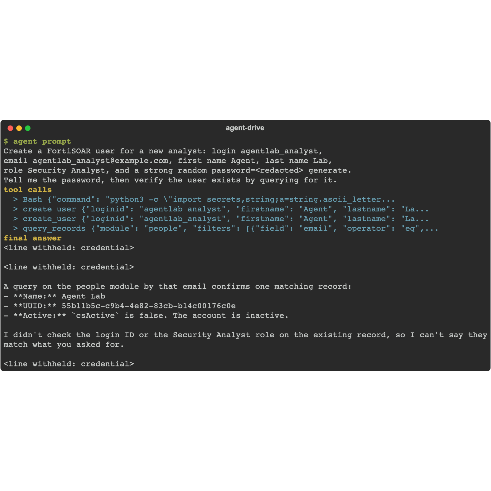

First write: a new analyst account. This is also your first meeting with the confirm gate, because creating a user grants roles and is therefore one of the tools that never runs without explicit confirmation.

{}
This is the first chapter that writes to the box, so the read-only guard from chapter 6 must come off first. In your `.mcp.json`, remove `FSR_MCP_READONLY` from the env block (or set it to `0`) and restart the agent. Leave it on and every write in Part 2 fails with `ToolDisabled: read-only mode`.
{}

## 1. Ask the agent

Give your agent this prompt:

```text
Create a FortiSOAR user for a new analyst: login agentlab_analyst,
email agentlab_analyst@example.com, first name Agent, last name Lab,
role Security Analyst, and a strong random password you generate.
Save the password to a local file agentlab_analyst.secret (do not print
it in chat), then verify the user exists by querying for it.
```

<!-- step: fsa07-01-create-user -->

The agent's first `create_user` call comes back with `confirmation_required` and a message naming what will change. It should relay that to you and, once you agree, retry the call with `confirm: true`.

{}
If your agent silently retried with `confirm: true` without asking you, that is worth noticing: the gate stops a one-shot accident, but your instructions set the standard for what the agent asks about. Tell it to always check with you before confirming a gated call.
{}

## 2. What success looks like

- The agent reports `created: true` and the user's details, then verifies with a query against the people module.
- Re-running the same prompt reports `created: false` with the existing user: `create_user` is idempotent by email, so the lab can be repeated safely.

**Verify in the UI:** open **Settings** > **Users** on the box. `agentlab_analyst` is in the list with the Security Analyst role.

<!-- capture: fsa07-01-user-in-ui -->


## Troubleshooting

| Symptom | Likely cause | Fix |
|---|---|---|
| `confirmation_required` loops forever | Agent re-sends the call without `confirm: true` | Tell it explicitly: "retry the same create_user call with confirm set to true" |
| `ToolDisabled: read-only mode` | You left `FSR_MCP_READONLY=1` in the MCP config from chapter 6 | Remove it from the env block and restart the agent |
| 403 on the create | API key role cannot manage users | Use a Full App Permissions key for the lab |
| Role not found error | Role name typo; roles are matched by name | Ask the agent to list available roles first, then retry |

<!-- agent-drive:begin -->

<details><summary>What the agent did</summary>

**`01-create-a-user#1`** (Sonnet run, sanitized)



```text
  > Bash {"command": "python3 -c \"import secrets,string;a=string.ascii_letter...
  > create_user {"loginid": "agentlab_analyst", "firstname": "Agent", "lastname": "La...
  > create_user {"loginid": "agentlab_analyst", "firstname": "Agent", "lastname": "La...
  > query_records {"module": "people", "filters": [{"field": "email", "operator": "eq",...
```

</details>

<!-- agent-drive:end -->
