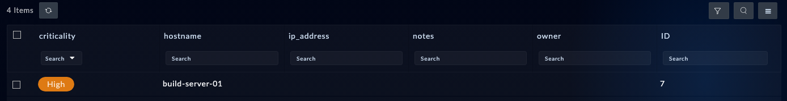

Now a schema change: a custom module for lab assets. This is the step where verification discipline starts to matter, because module creation is a two-phase operation (staging, then an appliance-wide publish) and a module without role permissions looks created but rejects every record write.

## 1. Ask the agent

Give your agent this prompt:

```text
Create a custom module named agentlab_assets (label "Agent Lab Assets") with
these fields: hostname (text, required), ip_address (text), owner (text),
criticality (picklist using the Severity picklist), and notes (rich text).
Grant Full App Permissions on it, publish the change, and then prove the
module works by describing it and creating one test record in it with
hostname build-server-01, criticality High. Show me the record you created.
```

<!-- step: fsa07-02-create-module -->

Expect three distinct phases, in order:

1. `create_module` with the field list and `grant_to` - the module lands in **staging**.
2. `publish` - confirm-gated (it commits every staged schema change appliance-wide). The agent must ask you before confirming.
3. `describe_module` + `create_record` + `get_record` - the proof the schema is live and writable.

{}
`publish` ships ALL staged schema changes on the appliance, not just yours. On a shared lab box, check with your neighbors (or your instructor) before letting the agent confirm it.
{}

## 2. What success looks like

- `publish` reports success after a minute or two of polling.
- `describe_module` lists your five fields with the right types, and the test record comes back with `hostname: build-server-01` and criticality resolved to the High picklist IRI.

**Verify in the UI:** the new module appears in the left navigation (you may need to reload the browser). Open it; the test record is there.

<!-- capture: fsa07-02-module-in-ui -->


## Troubleshooting

| Symptom | Likely cause | Fix |
|---|---|---|
| Record create returns 403 after publish | Module was created without `grant_to` | Ask the agent to re-run create_module with grant_to, or grant the role in Application Editor |
| Publish times out | Busy box; publishes poll a job | Ask the agent to retry publish; check System Configuration > Publish status in the UI |
| criticality arrives as plain text | Field was created as text, not a picklist binding | Delete the module (confirm-gated) and recreate; the field spec must name the picklist |
| Module not in the left nav | Browser cache | Hard-reload the FortiSOAR UI |
