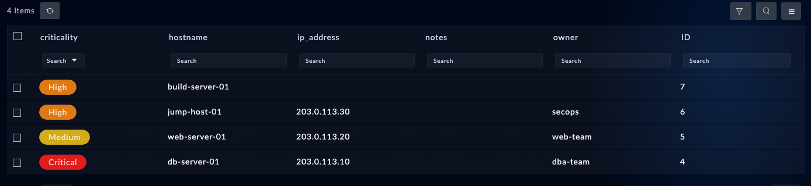

With the module live, exercise the record tools: create a handful of assets, query them, and look at the audit trail the agent has been leaving behind.

## 1. Seed records

Give your agent this prompt:

```text
In agentlab_assets, create these records (skip any that already exist,
matching on hostname):
- db-server-01, 203.0.113.10, owner dba-team, criticality Critical
- web-server-01, 203.0.113.20, owner web-team, criticality Medium
- jump-host-01, 203.0.113.30, owner secops, criticality High
Then query the module for criticality High or Critical, sorted by hostname,
and show me a table of what you found.
```

<!-- step: fsa07-03-seed-records -->

The agent should reach for `get_or_create_record` or `upsert_record` (idempotent, matching on `hostname`) rather than blind `create_record` calls, and use `query_records` with a filter for the read-back. The addresses are TEST-NET documentation ranges, safe for lab content.

## 2. What success looks like

- Three records created on the first run; zero on a re-run (the agent reports they already exist).
- The query returns db-server-01 and jump-host-01 (Critical + High), plus the build-server-01 test record from the previous page (also High), and not web-server-01.

**Verify in the UI:** open the Agent Lab Assets module and check the grid.

<!-- capture: fsa07-03-records-grid -->


## 3. Read the audit trail

Give your agent this prompt:

```text
Take the db-server-01 record in the agentlab_assets module and show me its
full lifecycle: every create/update event, who did it, and when. Use the
record's uuid.
```

<!-- step: fsa07-04-record-lifecycle -->

**What success looks like:** a timeline from `record_lifecycle` whose create event is attributed to your API key's user. Every write your agent has made in this chapter is in the box's audit log under that identity - this is why chapter 6 told you to make a dedicated key.

## Troubleshooting

| Symptom | Likely cause | Fix |
|---|---|---|
| Picklist error naming valid_values | Wrong casing like "critical" | The error lists the valid values; the agent should retry with the exact one |
| Query returns every record | Filter used the picklist display value against the IRI field | Ask the agent to filter on `criticality.itemValue` |
| Duplicate records after re-runs | Agent used create_record, not upsert | Delete the extras (confirm-gated) and redo with "skip any that already exist" |
