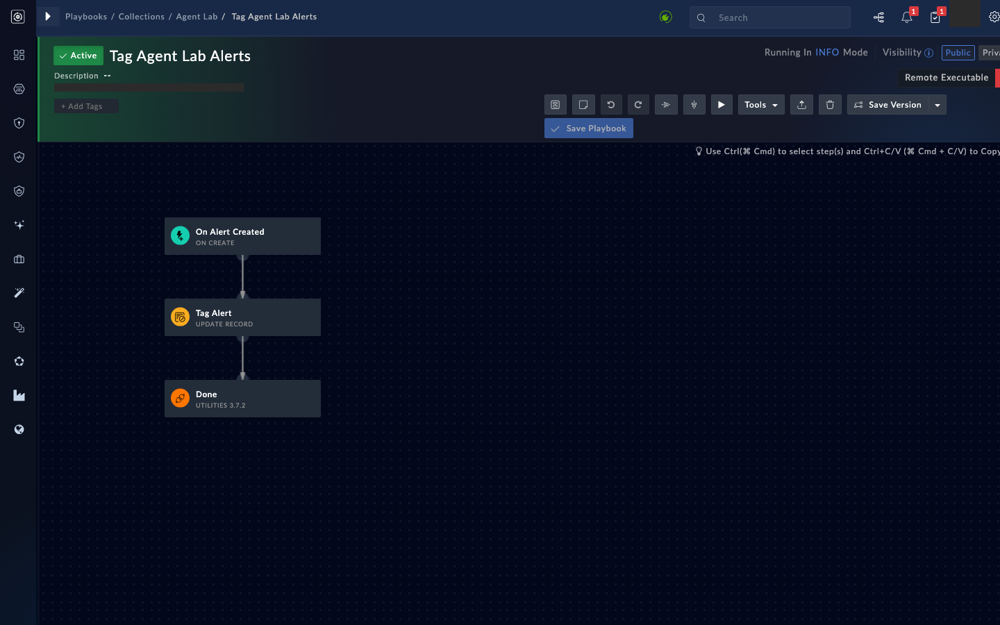
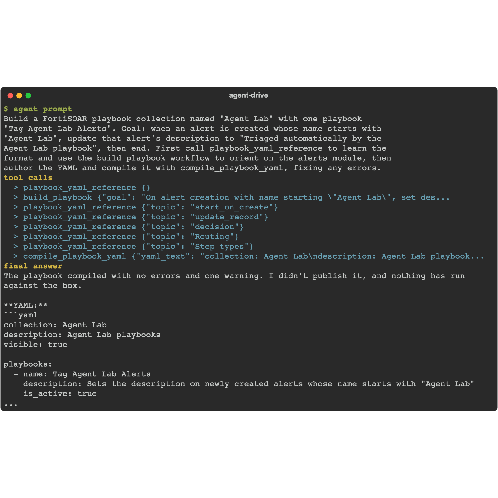
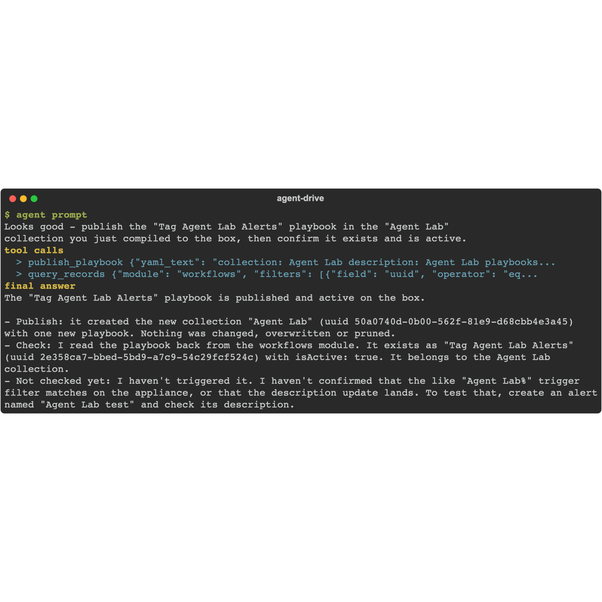

Playbooks are where agent work becomes durable: the agent investigates once, then bottles the procedure into automation that runs forever. The agent authors the playbook as YAML (the fsr_playbooks format), compiles it offline to catch mistakes, and only then pushes it to the box.

Your agent does not need to know the YAML format in advance: the toolkit ships it. The `playbook_yaml_reference` tool returns the step types, routing rules, Jinja idioms and worked examples, and the `build_playbook` workflow orients on the modules the playbook touches first. Steering the agent to those is the point of this lab - it is how a general coding agent becomes competent at FortiSOAR authoring without any private documentation.

## 1. Ask the agent

Give your agent this prompt:

```text
Build a FortiSOAR playbook collection named "Agent Lab" with one playbook
"Tag Agent Lab Alerts". Goal: when an alert is created whose name starts with
"Agent Lab", update that alert's description to "Triaged automatically by the
Agent Lab playbook", then end. Author the playbook YAML, compile it and fix any
errors, and show me the compiled result. Do not publish yet.
```

<!-- step: fsa08-01-compile-yaml -->

Working from the toolkit's reference, the agent should produce YAML along these lines and run `compile_playbook_yaml` on it:

```yaml
collection: Agent Lab
visible: true
playbooks:
  - name: Tag Agent Lab Alerts
    steps:
      - name: On Alert Created
        type: start_on_create
        module: alerts
        when:
          logic: AND
          filters:
            - field: name
              op: like
              value: "Agent Lab%"
        next: Tag Alert
      - name: Tag Alert
        type: update_record
        module: alerts
        record: "{{ vars.input.records[0]['@id'] }}"
        fields:
          description: "Triaged automatically by the Agent Lab playbook"
        next: Done
      - name: Done
        type: end
```

**What success looks like:** `compile_playbook_yaml` returns `ok: true` with the playbook name listed. The compile is fully offline - nothing touched the box yet. If it returns errors, each one carries a code, message and path; let the agent fix the YAML and recompile.

## 2. Publish

Give your agent this prompt:

```text
Looks good - publish the "Tag Agent Lab Alerts" playbook in the "Agent Lab"
collection you just compiled to the box, then confirm it exists and is active.
```

Name the collection and playbook in the prompt (not "that playbook"): the publish tool identifies the playbook by name, so a self-contained prompt still works if your agent session restarted or lost the earlier context.

<!-- step: fsa08-02-publish-playbook -->

**Verify in the UI:** open **Playbooks** in the left navigation. The "Agent Lab" collection holds "Tag Agent Lab Alerts"; open it and check the canvas shows the three steps with the on-create trigger.

<!-- capture: fsa08-02-playbook-canvas -->


{}
Once you are comfortable with these two calls, page 4 collapses them - plus the run itself - into one tool, `run_playbook_yaml`, which is how you should test-run a new playbook.
{}

## Troubleshooting

| Symptom | Likely cause | Fix |
|---|---|---|
| Agent guesses the YAML shape or reaches for outside docs | It skipped the toolkit's own reference | Tell it to call `playbook_yaml_reference` (and `build_playbook`) first; the format ships with the toolkit |
| "pip install pyfsr[playbooks]" error | The MCP server's environment lacks the compile extra | Reinstall `fsr-agentic-toolkit` where the MCP server runs, then restart the agent |
| Compile error no_trigger | Missing the start_on_create step | The YAML needs exactly one trigger step per playbook |
| Compile ok but publish fails | Collection name collision on the box | Rename the collection or ask the agent to list existing collections first |
| Playbook exists but shows inactive | Push did not activate it | Ask the agent to verify and activate it, or toggle it in the UI |

<!-- agent-drive:begin -->

<details><summary>What the agent did</summary>

**`01-author-and-publish#1`** (Sonnet run, sanitized)



```text
  > playbook_yaml_reference {}
  > playbook_yaml_reference {"topic": "update_record"}
  > playbook_yaml_reference {"topic": "start_on_create"}
  > playbook_yaml_reference {"topic": "Step types"}
  > compile_playbook_yaml {"yaml_text": "collection: Agent Lab description: Agent Lab playbooks...
```

**`01-author-and-publish#2`** (Sonnet run, sanitized)



```text
  > publish_playbook {"yaml_text": "collection: Agent Lab description: Agent Lab playbooks...
  > query_records {"module": "workflows", "filters": [{"field": "uuid", "operator": "eq...
```

</details>

<!-- agent-drive:end -->
