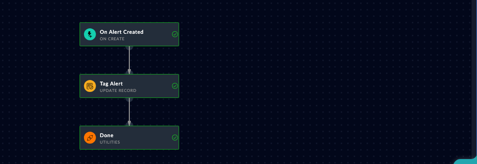

A published playbook is a claim. Proof is a record that triggers it, a run that finishes, and the effect read back from the record. That whole loop is one prompt.

## 1. Ask the agent

Give your agent this prompt:

```text
Create an alert named "Agent Lab - suspicious login on jump-host-01" with
severity High and source "Agent Lab Workshop". Then wait for the
"Tag Agent Lab Alerts" playbook run that it triggers, tell me whether the
run finished cleanly (diagnose it if not), and finally fetch the alert
again to prove its description was updated by the playbook.
```

<!-- step: fsa08-03-trigger-and-verify -->

Watch the tool sequence - it is the verification pattern from chapter 1 end to end:

1. `create_record` on alerts (the trigger fires server-side),
2. `wait_for_playbook_run` scoped to the playbook name,
3. `diagnose_run` if anything looks off - it diffs the defined steps against what actually ran,
4. `get_record` on the alert: the description now reads "Triaged automatically by the Agent Lab playbook".

## 2. What success looks like

- The run reaches `finished` within a few seconds.
- The alert's description changed - the read-back is the proof, not the run status.

**Verify in the UI:** open the alert; its description shows the playbook's text. Open **Automation** > **Playbooks** > **Executed Playbooks** (the run history) and find the run.

<!-- capture: fsa08-03-run-history -->


{}
Ask the agent for the record's lifecycle (`record_lifecycle`) and you get the whole story in one timeline: your create, the trigger, the playbook's update - each attributed and timestamped.
{}

## Troubleshooting

| Symptom | Likely cause | Fix |
|---|---|---|
| wait_for_playbook_run times out | Trigger filter did not match | Alert name must start with "Agent Lab"; check the playbook's trigger filter |
| Run failed at Tag Alert | The update step's record reference | diagnose_run names the failing step and error; common cause is a mangled Jinja reference |
| Run finished but description unchanged | Updated the wrong record or wrong field | Check the run's step results via get_playbook_run; read the alert by uuid |
| Nothing in Executed Playbooks | Playbook inactive | Activate it and create a fresh alert (triggers do not fire retroactively) |
