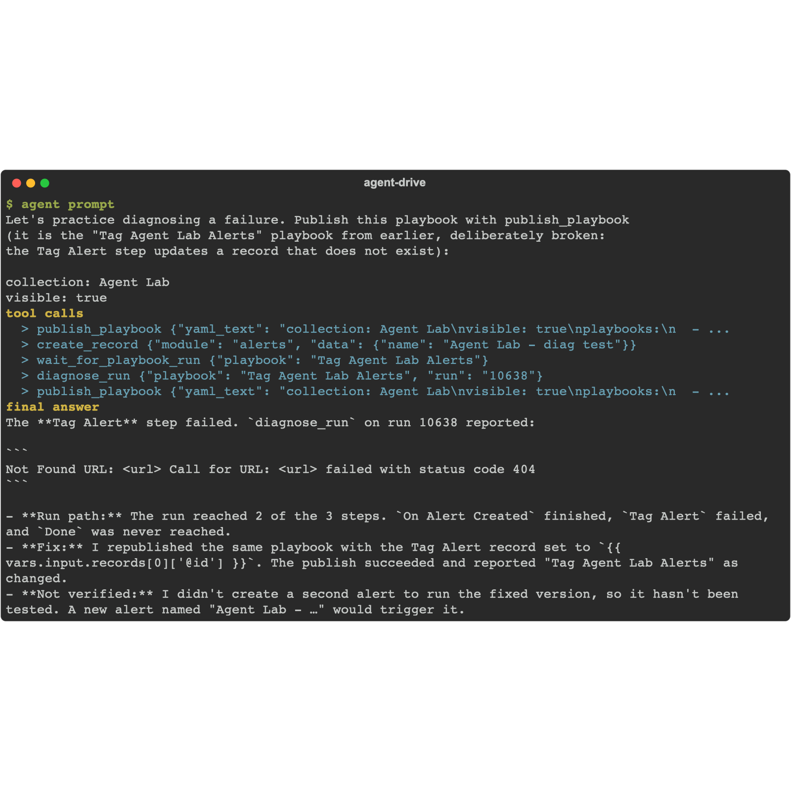

A playbook that runs is not a playbook that works. Sooner or later a run fails, and the question is always the same: which step, and why. The run log answers it eventually; the agent answers it in one prompt. It diffs the playbook's step graph against what actually executed, names the failing step and its error verbatim, and then fixes it.

To practice this safely, you break the playbook from chapter 8 on purpose, watch it fail, diagnose it, and put it back.

## 1. Ask the agent

The agent cannot export a live playbook's YAML, so give it the YAML to publish - this is the chapter 8 playbook with the Tag Alert step pointed at a record that does not exist. Give your agent this prompt (paste the YAML as shown):

```text
Let's practice diagnosing a failure. Publish this playbook with publish_playbook
(it is the "Tag Agent Lab Alerts" playbook from earlier, deliberately broken:
the Tag Alert step updates a record that does not exist):

collection: Agent Lab
visible: true
playbooks:
  - name: Tag Agent Lab Alerts
    steps:
      - name: On Alert Created
        type: start_on_create
        module: alerts
        when:
          logic: AND
          filters:
            - field: name
              op: like
              value: "Agent Lab%"
        next: Tag Alert
      - name: Tag Alert
        type: update_record
        module: alerts
        record: "/api/3/alerts/00000000-0000-0000-0000-000000000000"
        fields:
          description: "Triaged automatically by the Agent Lab playbook"
        next: Done
      - name: Done
        type: end

Then create an alert named "Agent Lab - diag test" to trigger it, and wait for
the run. Use diagnose_run on that run and tell me which step failed and the
error verbatim. Finally, fix it: republish the same playbook with the Tag Alert
record set back to "{{ vars.input.records[0]['@id'] }}", and confirm it published.
```

<!-- step: fsa08-04-diagnose-run -->

Watch the tool sequence: `publish_playbook` (the broken version), `create_record` to trigger it, `wait_for_playbook_run` which comes back `failed`, then `diagnose_run`, and finally `publish_playbook` again to restore the good version.

{}
Use `diagnose_run`, not `debug_run`. `diagnose_run` reads a finished run and diffs it against the definition; it is the right tool for "why did this fail". (If your agent reaches for a compile-time debugger here, point it at `diagnose_run`.)
{}

## 2. What the diagnosis tells you

`diagnose_run` does not just say "it failed". It returns the whole picture:

- **`failing_step`**: `Tag Alert` - the exact step, by name.
- **`error_message`**: the platform's error verbatim, here a `404 Not Found` on the missing record.
- **the step graph with statuses**: `On Alert Created` finished, `Tag Alert` failed, `Done` was never reached.

That is the difference between "the run is red" and "the update step tried to write to a record that is not there." The second one tells you what to change.

## 3. The break-fix loop

This is the loop you will run for real whenever a playbook misbehaves:

1. **Reproduce**: trigger the playbook so there is a fresh failed run to look at.
2. **Diagnose**: `diagnose_run` names the step and the error.
3. **Fix**: change the one step the diagnosis named, republish, trigger again.
4. **Confirm**: the run finishes and the effect lands (read the record back, as in page 2).

The agent can do all four from one request. Your job is to read what it changed and confirm the fix, not to hunt through the run log yourself.

## Troubleshooting

| Symptom | Likely cause | Fix |
|---|---|---|
| wait_for_playbook_run never returns failed | The broken playbook did not re-activate after republish | Ask the agent to confirm the playbook is active, then trigger a fresh alert |
| diagnose_run says the run was not found | Diagnosing the wrong run, or the run is still in flight | Diagnose the newest run of the playbook by name, after the wait returns |
| The fix did not take | The restore republished the broken YAML | Check the record reference the agent put back; it must be the triggering alert's id, not the all-zeros placeholder |
| A later chapter's playbook misbehaves | The lab playbook was left broken | Re-run the fix step, or republish the correct YAML from chapter 8 page 1 |

<!-- agent-drive:begin -->

<details><summary>What the agent did</summary>

**`03-diagnose-a-failed-run#1`** (Sonnet run, sanitized)



```text
  > publish_playbook {"yaml_text": "collection: Agent Lab\nvisible: true\nplaybooks:\n  - ...
  > create_record {"module": "alerts", "data": {"name": "Agent Lab - diag test"}}
  > wait_for_playbook_run {"playbook": "Tag Agent Lab Alerts"}
  > diagnose_run {"playbook": "Tag Agent Lab Alerts", "run": "10638"}
  > publish_playbook {"yaml_text": "collection: Agent Lab\nvisible: true\nplaybooks:\n  - ...
```

</details>

<!-- agent-drive:end -->
