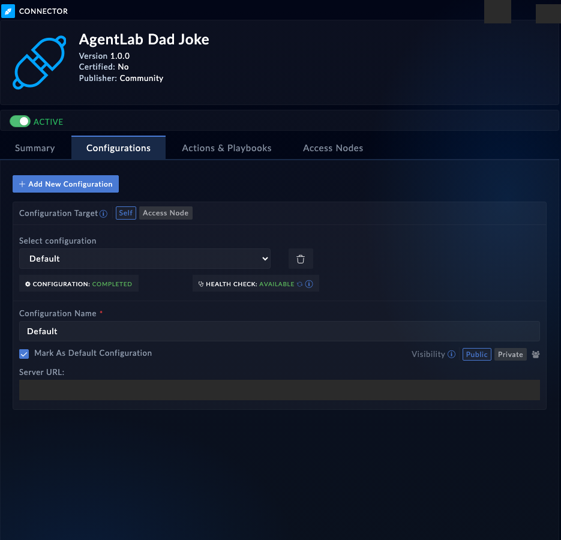

Connectors are FortiSOAR's hands: every firewall, sandbox and ticket system is reached through one. An agent that can discover and run them can chain real enrichment and response actions - which is exactly what the capstone needs.

## 1. Discover

Give your agent this prompt:

```text
List the connectors installed on this box. Pick one that is configured and
healthy (healthcheck it to prove that), list its operations, and explain
what parameters its simplest read-only operation takes.
```

<!-- step: fsa09-01-discover-connectors -->

The agent should walk `list_connectors` (configured connectors show a config count), `healthcheck_connector` (green is `Available`), and `list_connector_operations` - which reads the live box, so the operations match the installed version exactly.

## 2. Run an operation

Give your agent this prompt (adapt the connector to what your box has - the built-in utilities connector is always there):

```text
Run a harmless read-only operation on that connector and interpret the
result for me. If nothing fits, use the code-snippet or utilities
connector to evaluate 2+2 as a demonstration.
```

<!-- step: fsa09-02-run-operation -->

**What success looks like:** the agent names the operation it chose, shows the params it sent, and interprets the `data` payload rather than dumping it. A failed call is also a success for learning: the error dict carries the HTTP method, path and response body, which the agent should quote when explaining what went wrong.

**Verify in the UI:** open **Automation** > **Connectors**, find the connector, and check its health and configuration match what the agent claimed.

<!-- capture: fsa09-02-connector-page -->


## Troubleshooting

| Symptom | Likely cause | Fix |
|---|---|---|
| healthcheck says no-config | Connector installed but never configured | Pick another, or configure it (the agent can: default_connector_config then upsert_connector_configuration) |
| Operation fails with a params error | Wrong parameter names | list_connector_operations shows each operation's exact parameter names and types |
| run_connector_operation returns empty data | Some connectors are fire-and-forget | Not a failure; check the connector's own logs or pick a synchronous operation |
