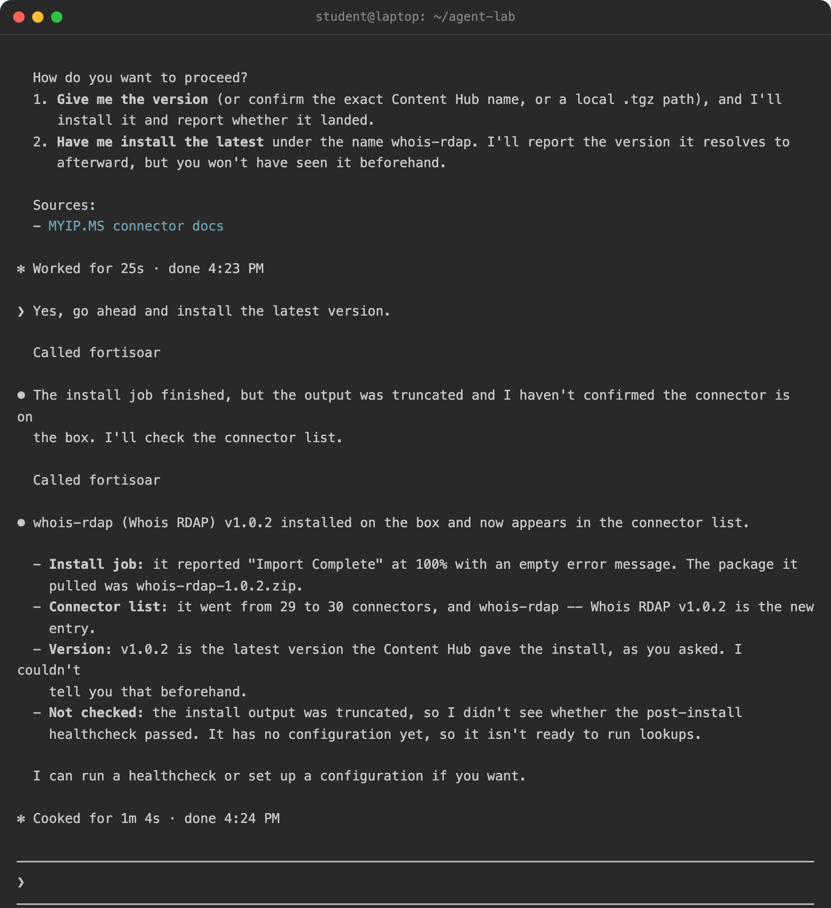
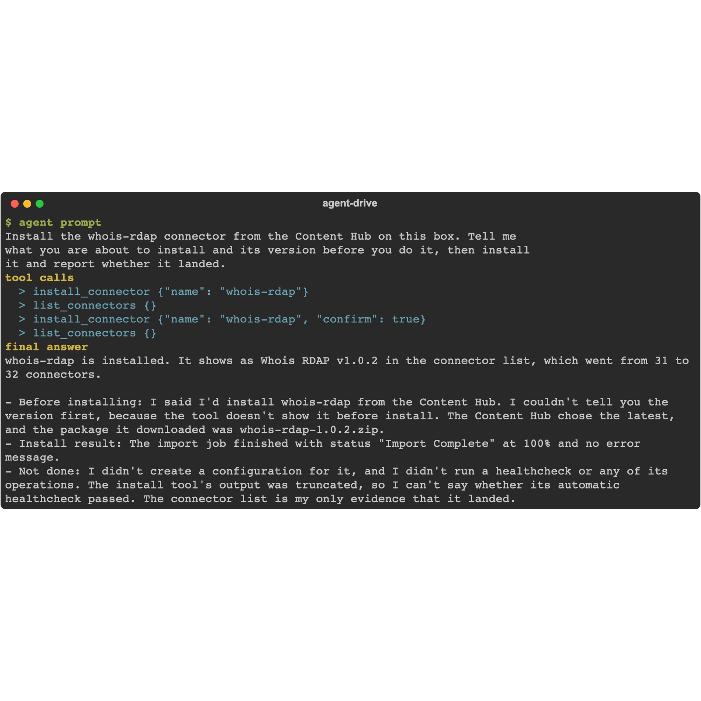
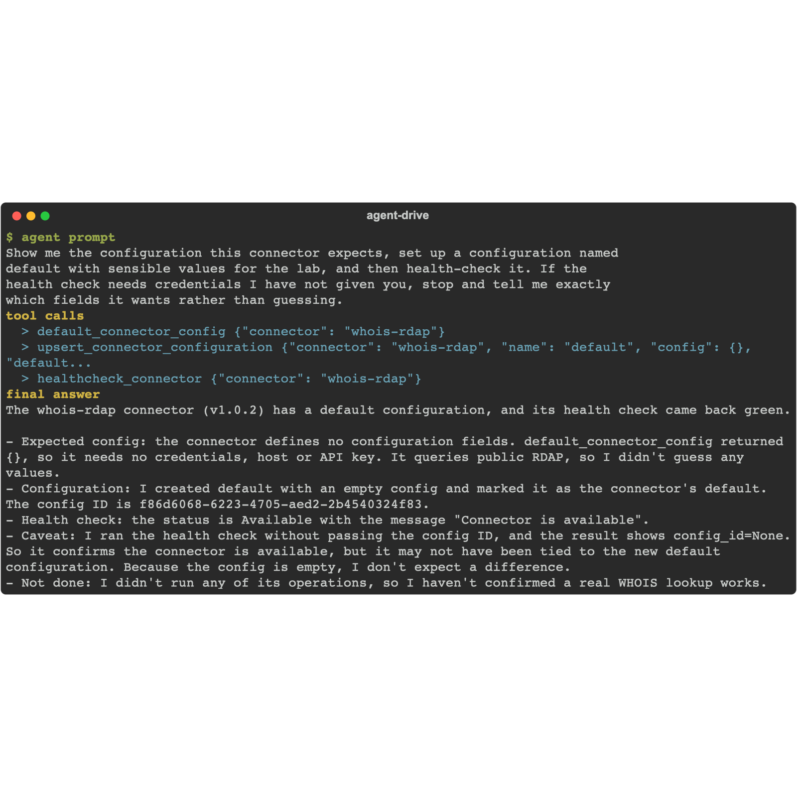

The last page ran a connector the box already had. Most real work starts a step earlier: the connector you need is in the **Content Hub** but not installed yet. The agent can install it by name, configure it, and health-check it - the same loop you would do by hand, driven from the chat.

{}
Installing a connector puts executable code on the appliance, so this is a confirm-gated action: the agent tells you what it is about to install and waits for your go-ahead. Run it in the lab working folder from chapter 6, with the read-only surface removed (chapter 7).
{}

## 1. Install

Give your agent this prompt. We use **whois-rdap** - a self-contained enrichment connector that looks up domain and IP registration over RDAP and needs no credentials - but the loop is the same for any connector your Content Hub offers; swap the name:

```text
Install the whois-rdap connector from the Content Hub on this box. Tell me
what you are about to install and its version before you do it, then install
it and report whether it landed.
```

<!-- step: fsa09-06-install-from-hub -->

Behind the prompt the agent calls `install_connector` with a **name** (not a local path): the toolkit resolves it against the box's Content Hub and installs the latest version, or the one you name. It is the same tool chapter 9's "build your own" lab uses with a `path` - name for the hub, path for a `.tgz` you built.

## 2. Configure and health-check

Give your agent this prompt:

```text
Show me the configuration this connector expects, set up a configuration named
default with sensible values for the lab, and then health-check it. If the
health check needs credentials I have not given you, stop and tell me exactly
which fields it wants rather than guessing.
```

<!-- step: fsa09-07-configure-and-health -->

The agent walks `default_connector_config` (the expected config shape), `upsert_connector_configuration` (create or update the `default` config), and `healthcheck_connector`. A connector that reaches an external service will report unhealthy until you give it real credentials - that is the connector telling the truth, not a failure of the agent. A self-contained connector goes green on its own.

**You are done when:** the agent names the connector and version it installed, shows the config fields, and reports the health result plainly - green, or a precise list of the credentials it still needs.

**Verify in the UI:** open **Connectors** (it opens the Content Hub on the Connectors filter). The connector now shows as installed, with the `default` configuration and its health state.

<!-- capture: fsa09-06-install-from-hub -->


## Troubleshooting

| Symptom | Likely cause | Fix |
|---|---|---|
| Install fails: connector not found | The name does not match a Content Hub entry | Ask the agent to list the Content Hub, or check the exact name in the UI |
| Install fails: already installed | The connector is present | Skip to configure, or reinstall with `replace` to move versions |
| Health check is unhealthy | The connector needs real credentials or a reachable service | Give it valid config; a connector to an external API cannot be healthy without one |
| 403 on install | The key's role cannot manage connectors | Add Application Administrator to the key's role (chapter 6) |

<!-- agent-drive:begin -->

<details><summary>What the agent did</summary>

**`01b-install-from-content-hub#1`** (Sonnet run, sanitized)



```text
  > install_connector {"name": "whois-rdap"}
  > list_connectors {}
  > install_connector {"name": "whois-rdap", "confirm": true}
  > list_connectors {}
```

**`01b-install-from-content-hub#2`** (Sonnet run, sanitized)



```text
  > default_connector_config {"connector": "whois-rdap"}
  > upsert_connector_configuration {"connector": "whois-rdap", "name": "default", "config": {}, "default...
  > healthcheck_connector {"connector": "whois-rdap"}
```

</details>

<!-- agent-drive:end -->
