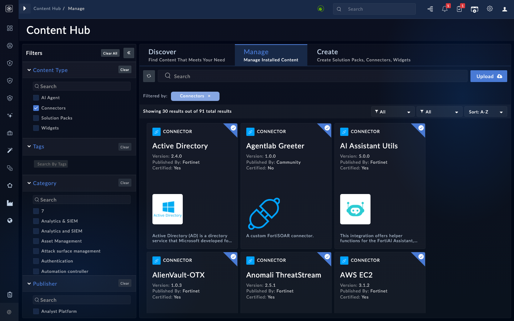

The full loop: scaffold, implement, package, deploy, run. The agent does the coding on your workstation with the `pyfsr connector` CLI, installs the result through the confirm-gated `install_connector` tool, and proves it by running the new operation.

{}
This lab writes code on your machine and installs it on the box. Run it in the lab working folder from chapter 6. For connector development at production depth (ingestion, output schemas, Content Hub publishing), see the separate FortiSOAR Connectors workshop.
{}

## 1. Scaffold and implement

Give your agent this prompt:

```text
Using the pyfsr CLI (pyfsr connector scaffold), scaffold a connector named
agentlab-greeter in this folder. Then edit it: rename the ping operation to
greet, taking a "name" parameter and returning {"greeting": "Hello <name>
from FortiSOAR"}. Keep info.json's operation list in sync with
operations.py. Show me the diff of what you changed.
```

<!-- step: fsa09-03-scaffold-connector -->

The scaffold ships a working skeleton (one `server` config field, one operation, a health check), so the agent edits a running starting point instead of writing boilerplate. Review the diff like you would any code review - `info.json`'s `operations` entry and the `operations.py` dict must agree on the operation name.

## 2. Package and deploy

Give your agent this prompt:

```text
Package the connector (pyfsr connector package agentlab-greeter) and then
install the resulting .tgz on the box with the install_connector tool.
If install_connector fails with "already active", do not stop there: call
install_connector again with the same .tgz and replace=true (this replaces
only agentlab-greeter). Then configure it with server
https://fortisoar.example.com and healthcheck it.
```

<!-- step: fsa09-04-deploy-connector -->

`install_connector` is confirm-gated (it puts executable code on the appliance): the agent must tell you what it is installing and get your go-ahead. The healthcheck after install closes the loop.

## 3. Run it

Give your agent this prompt:

```text
Run the greet operation of agentlab-greeter with name "TEC Workshop" and
show me the result.
```

<!-- step: fsa09-05-run-own-connector -->

**What success looks like:** `{"greeting": "Hello TEC Workshop from FortiSOAR"}` - produced by code your agent wrote, running inside FortiSOAR's connector runtime.

**Verify in the UI:** **Connectors** now lists Agentlab Greeter v1.0.0 (Content Hub, Manage, filtered to Connectors) as installed.

<!-- capture: fsa09-05-greeter-installed -->


## Troubleshooting

| Symptom | Likely cause | Fix |
|---|---|---|
| pyfsr: command not found | The CLI is in a venv the agent's shell does not see | `pip install fsr-agentic-toolkit==0.1.2` into the active environment |
| package fails: missing required file | A core file was renamed or deleted | info.json, connector.py, operations.py, requirements.txt must all exist |
| Install succeeds, operation unknown | info.json and operations.py disagree | The operation name must match in both; repackage and redeploy (deploys replace) |
| Healthcheck fails after configure | The scaffold's check requires the server field | Pass a server value when configuring |

<!-- agent-drive:begin -->

<details><summary>What the agent did</summary>

**`02-build-a-connector#1`** (Sonnet run, sanitized)


```text
  > Bash {"command": "pyfsr connector scaffold --help; ls -la"}
  > Bash {"command": "pyfsr connector scaffold agentlab-greeter && cd agentlab...
  > Bash {"command": "python3 - <<'E'\np='operations.py'\ns=open(p).read()\na=...
```

**`02-build-a-connector#2`** (Sonnet run, sanitized)


```text
  > Bash {"command": "pyfsr connector package agentlab-greeter 2>&1 | tail -20...
  > install_connector {"path": "<repo>", "confirm": true}
  > install_connector {"path": "<repo>", "confirm": true, "replace": true}
  > upsert_connector_configuration {"connector": "agentlab-greeter", "name": "default", "config": {"serv...
  > healthcheck_connector {"connector": "agentlab-greeter"}
```

**`02-build-a-connector#3`** (Sonnet run, sanitized)


```text
  > run_connector_operation {"connector": "agentlab-greeter", "operation": "greet", "params": {"n...
```

</details>

<!-- agent-drive:end -->
