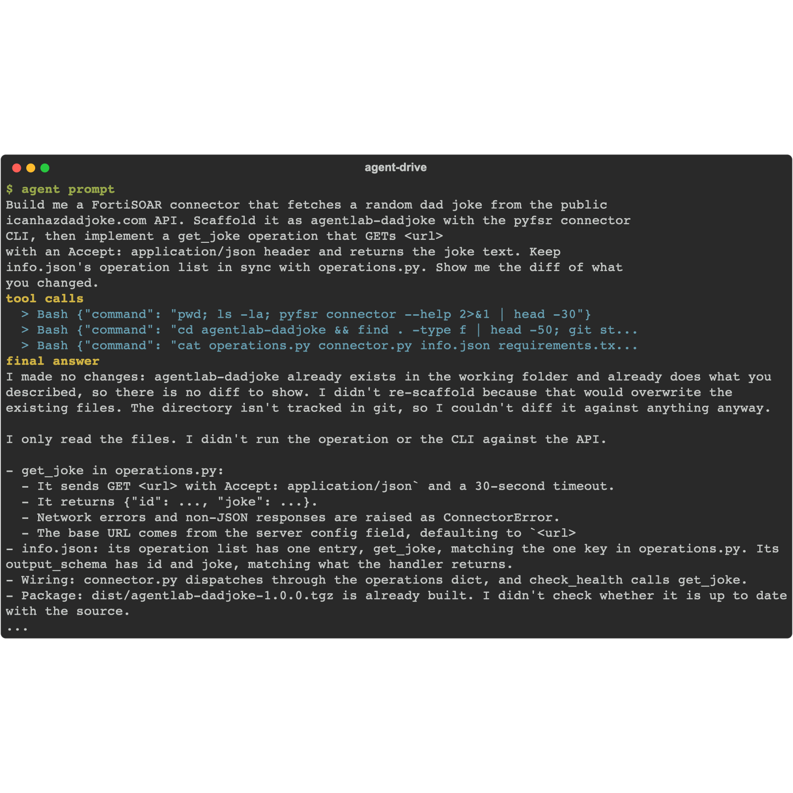
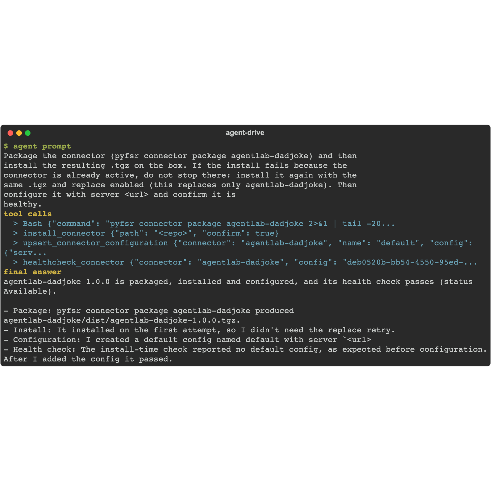
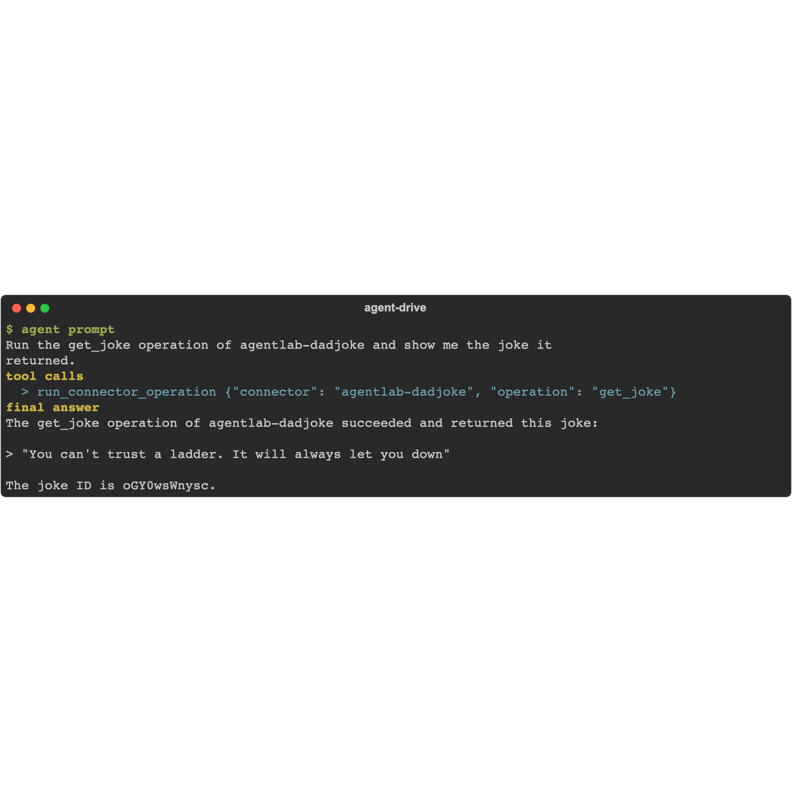

You do not write the connector. You describe what it should do, and the agent builds it: scaffolds the project on your workstation with the `pyfsr connector` CLI, writes the operation code, packages it, installs it on the box, and proves it by running the new operation. The example here is a fun one - a connector that fetches a random dad joke - but the loop is the point: the same prompt shape builds a connector for any service you can describe, from a threat-intel feed to an internal ticketing API.

{}
This lab writes code on your machine and installs it on the box. Run it in the lab working folder from chapter 6. For connector development at production depth (ingestion, output schemas, Content Hub publishing), see the separate FortiSOAR Connectors workshop.
{}

## 1. Scaffold and implement

Give your agent this prompt:

```text
Build me a FortiSOAR connector that fetches a random dad joke from the public
icanhazdadjoke.com API. Scaffold it as agentlab-dadjoke with the pyfsr connector
CLI, then implement a get_joke operation that GETs https://icanhazdadjoke.com
with an Accept: application/json header and returns the joke text. Keep
info.json's operation list in sync with operations.py. Show me the diff of what
you changed.
```

<!-- step: fsa09-03-scaffold-connector -->

The scaffold ships a working skeleton (one `server` config field, one operation, a health check), so the agent edits a running starting point instead of writing boilerplate. Review the diff like you would any code review - `info.json`'s `operations` entry and the `operations.py` dict must agree on the operation name. Nothing about this is dad-joke-specific: swap the API and the operation and the agent builds whatever connector you asked for.

## 2. Package and deploy

Give your agent this prompt:

```text
Package the connector (pyfsr connector package agentlab-dadjoke) and then
install the resulting .tgz on the box. If the install fails because the
connector is already active, do not stop there: install it again with the
same .tgz and replace enabled (this replaces only agentlab-dadjoke). Then
configure it with server https://icanhazdadjoke.com and confirm it is
healthy.
```

<!-- step: fsa09-04-deploy-connector -->

Installing a connector is confirm-gated (it puts executable code on the appliance): the agent must tell you what it is installing and get your go-ahead. The healthcheck after install closes the loop.

## 3. Run it

Give your agent this prompt:

```text
Run the get_joke operation of agentlab-dadjoke and show me the joke it
returned.
```

<!-- step: fsa09-05-run-own-connector -->

**What success looks like:** a real dad joke comes back - produced by code your agent wrote, calling a live external API from inside FortiSOAR's connector runtime.

**Verify in the UI:** **Connectors** now lists AgentLab Dad Joke v1.0.0 (Content Hub, Manage, filtered to Connectors) as installed.

<!-- capture: fsa09-05-dadjoke-installed -->


## Troubleshooting

| Symptom | Likely cause | Fix |
|---|---|---|
| pyfsr: command not found | The CLI is in a venv the agent's shell does not see | `pip install fsr-agentic-toolkit` into the active environment |
| package fails: missing required file | A core file was renamed or deleted | info.json, connector.py, operations.py, requirements.txt must all exist |
| Install succeeds, operation unknown | info.json and operations.py disagree | The operation name must match in both; repackage and redeploy (deploys replace) |
| Healthcheck or get_joke times out | The box cannot reach icanhazdadjoke.com | The connector runs on the appliance, which needs outbound HTTPS to the API. On an air-gapped box, point the connector at a service the box can reach instead |

<!-- agent-drive:begin -->

<details><summary>What the agent did</summary>

**`02-build-a-connector#1`** (Sonnet run, sanitized)



```text
  > Bash {"command": "pwd; ls -la; pyfsr connector --help 2>&1 | head -30"}
  > Bash {"command": "cd agentlab-dadjoke && find . -type f | head -50; git st...
  > Bash {"command": "cat operations.py connector.py info.json requirements.tx...
```

**`02-build-a-connector#2`** (Sonnet run, sanitized)



```text
  > Bash {"command": "pyfsr connector package agentlab-dadjoke 2>&1 | tail -20...
  > install_connector {"path": "<repo>", "confirm": true}
  > upsert_connector_configuration {"connector": "agentlab-dadjoke", "name": "default", "config": {"serv...
  > healthcheck_connector {"connector": "agentlab-dadjoke", "config": "deb0520b-bb54-4550-95ed-...
```

**`02-build-a-connector#3`** (Sonnet run, sanitized)



```text
  > run_connector_operation {"connector": "agentlab-dadjoke", "operation": "get_joke"}
```

</details>

<!-- agent-drive:end -->
